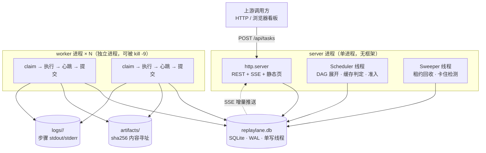
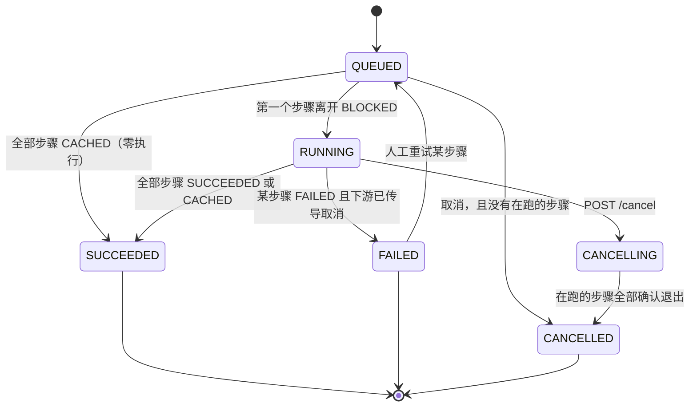
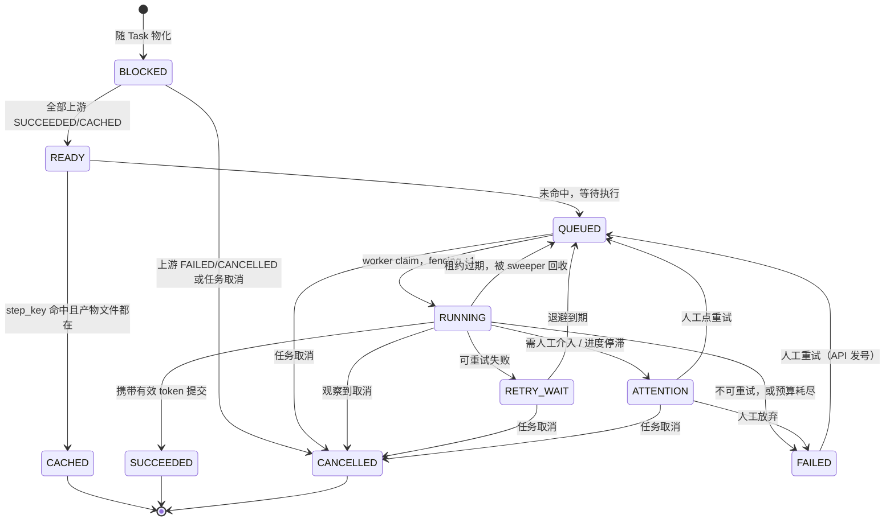
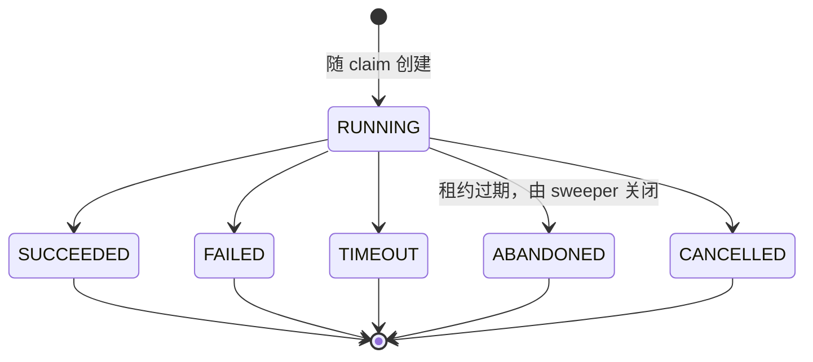
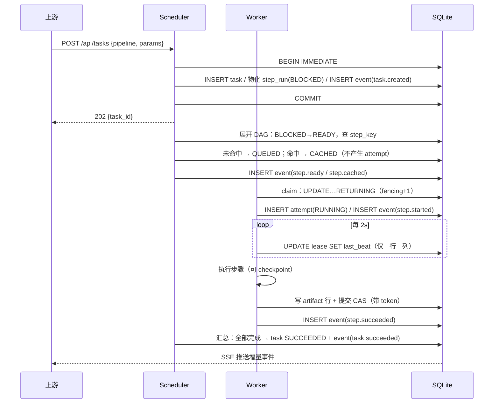
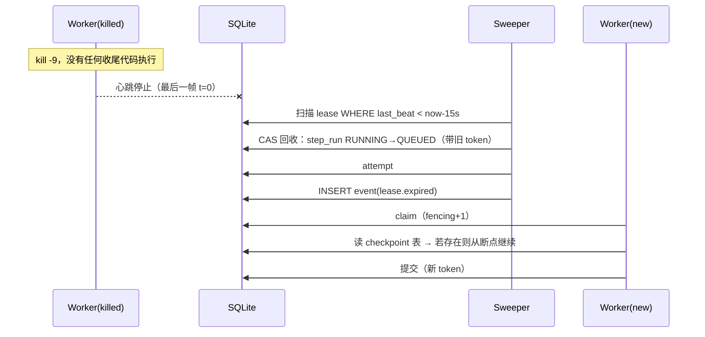

# replaylane

**可观测、可恢复的 AI 任务执行管线 — 架构与边界设计**

> 笔试 题 D 交付物 · 设计详述（配套 [`README.md`](../README.md) 阅读）
> 版本 v1.1 · 2026-10-30 · v1.1 变更：按实现结果修正了状态机（补 4 条取消边、`QUEUED → SUCCEEDED`、
> `FAILED → QUEUED`）、领取与回收 SQL（补 `INSERT lease` 与显存释放）、GC 引用口径（补 `step_cache`）、
> 甘特坐标系（顺序用 seq、宽度用 mono_ms）、规模与工时口径，并补 10.4 实现阶段失败案例。

---

## 目录

- [0. 一页纸](#0-一页纸)
- [1. 实现方式与时间规划](#1-实现方式与时间规划)
- [2. 执行模型与状态机](#2-执行模型与状态机)
- [3. 步骤定义与依赖关系](#3-步骤定义与依赖关系)
- [4. 长任务、状态管理与失败恢复](#4-长任务状态管理与失败恢复)
- [5. 持久化边界](#5-持久化边界)
- [6. 可观测性设计](#6-可观测性设计)
- [7. GPU 资源调度与可观测](#7-gpu-资源调度与可观测)
- [8. 从秒级到小时级：同一套设计的形变](#8-从秒级到小时级同一套设计的形变)
- [9. 边界与取舍](#9-边界与取舍)
- [10. AI 使用说明与个人投入](#10-ai-使用说明与个人投入)
- [11. 下一步](#11-下一步)
- [附录 A：笔试必答项映射](#附录-a笔试必答项映射)

---

## 0. 一页纸

### 0.1 问题

一个动画素材处理任务由多个耗时步骤组成（抽帧、抠像、风格化重绘、时序校正、转码……）。它有三个现实属性：

1. **会失败**：GPU OOM、外部 API 限流、某一步的数据格式不合法。
2. **会中断**：进程被 kill、机器重启、容器被驱逐。执行到第 40 分钟的进程不会留下任何遗言。
3. **会很长**：单步可能是分钟到小时级，整条管线可能是几小时。

因此系统必须回答三个问题：**断了从哪继续？重跑会不会重复花钱？上游现在到底跑到哪了？**

### 0.2 方案（五句话）

1. 状态只在 SQLite 里，队列就是 `step_run` 表上的一个索引——**没有内存队列，所以重启不丢任务**。
2. 执行权是**租约**（lease）+ 单调递增的 **fencing token**。任何 worker 的写入都必须带上自己那一次的 token，过期即被拒绝。
3. 每个步骤有内容寻址的 `step_key`，产物落在磁盘的内容寻址目录里；**键相同就直接复用，不重跑**。
4. 恢复不是特殊分支：sweeper 把过期租约改回待领取，调度器下一轮自然重新派发——**崩溃恢复和正常调度是同一条代码路径**。
5. 所有状态变化先写 append-only 的 `event`，再更新物化表；看板通过 SSE 订阅 event，断了用 `Last-Event-ID` 从 DB 补。

### 0.3 三条设计原则

| 原则 | 具体含义 | 反面（被刻意拒绝的做法） |
|---|---|---|
| **能删就删** | 不引入 Redis / Celery / Kafka / Temporal。队列、锁、注册表全部用一张表表达 | "上一个项目用 Celery，这里也用" |
| **一个断言撑起正确性** | 全系统只有一条不变量：*过期 token 的写入必被拒绝*。其余性质由它推导 | 靠"记得先判断 status"的约定 |
| **状态即事件** | event 是真源，表是投影，投影可被重放验证 | 只写表不写事件，事后无法复盘 |

### 0.4 总体架构



**这张图里最重要的一件事**：worker 不接收"派发"。它自己轮询 DB 领任务。所以 server 挂了、worker 活着，任务照跑；worker 挂了、server 活着，sweeper 会把它手上的活收回去。两者之间唯一的耦合是那张表。

### 0.5 明确不做（详见第 9 章）

多机分布式调度 · 跨服务 exactly-once · 通用工作流 DSL · 多租户鉴权 · HA · saga 补偿 · 实时流处理。

### 0.6 启动方式

```bash
python -m replaylane.server --db ./data/replaylane.db --port 8000
python -m replaylane.worker --db ./data/replaylane.db --id w1   # 另开终端，可开多个
```

打开 `http://localhost:8000` 即看板。无第三方依赖，`python -m compileall` 通过即可跑。

---

## 1. 实现方式与时间规划

### 1.1 目录结构

```
replaylane/
├── README.md                     # 笔试交付说明（按题面 7 条组织）
├── docs/
│   ├── 01-架构与边界设计.md       # 本文
│   └── 02-实现决策.md             # 实现期改掉的设计决策、与本文的偏离
├── replaylane/
│   ├── schema.sql                 # 全部 DDL（12 张表），读完即知全部状态
│   ├── db.py                      # 写事务 / CAS 助手 / 事件追加
│   ├── model.py                   # 状态枚举、合法转移表、失败裁决
│   ├── pipeline.py                # 管线 DSL + 内容寻址 key
│   ├── steps.py                   # 8 个 Mock 步骤（真 sleep、真产物、真分片）
│   ├── scheduler.py               # DAG 展开、缓存判定、任务状态投影、人工干预
│   ├── worker.py                  # 领取、心跳、checkpoint、带 token 提交、僵尸退出
│   ├── sweeper.py                 # 租约回收、卡住检测、产物 GC
│   ├── gpu.py                     # 显存账本、准入控制、孤儿清理
│   ├── server.py                  # 路由、SSE、静态文件
│   ├── verify.py                  # 事件重放校验投影
│   ├── cli.py                     # 命令行入口（serve / demo / worker / verify）
│   └── web/
│       ├── index.html             # 单页看板
│       ├── app.js                 # 事件驱动渲染 + 甘特
│       └── style.css
└── tests/
    ├── test_state_machine.py      # 转移表合法性与任务状态推导
    ├── test_fencing.py            # 僵尸写入必须无效（A1/A2）
    ├── test_recovery.py           # kill -9 后自动续跑 + 分片复用（A7）
    ├── test_cache.py              # 相同输入跨任务复用（A8）
    └── test_retry.py              # 重试裁决 + OOM 降级
```

> 故障注入没有单独的 `faults.py`：它藏在任务参数里（`params.faults`），
> 由 `steps.StepContext.maybe_fail()` 读取。少一个模块，也少一处"只在演示时才走"的路径。

### 1.2 模块职责与规模（预算 vs 实际）

| 模块 | 职责（一句话） | 预算 | 实际 | 复杂度 |
|---|---|---|---|---|
| `schema.sql` | 全部表、索引；读完即知全部状态 | ~180 | 199 | 低 |
| `db.py` | 把"写事务 + CAS"封装成 `tx()` 与 `cas()`，业务层不写裸 SQL 事务 | ~220 | 156 | 中 |
| `model.py` | 状态枚举 + 合法转移表（测试直接遍历它） | ~150 | 151 | 低 |
| `pipeline.py` | DSL：步骤声明、依赖、重试策略、资源需求 | ~200 | 126 | 低 |
| `steps.py` | 8 个 Mock 步骤：sleep + 写产物 + 分片 checkpoint | ~260 | 143 | 低 |
| `scheduler.py` | 唯一一处决定"下一步该干什么"的地方 | ~300 | 331 | **高** |
| `worker.py` | 唯一一处执行步骤的地方；领取/心跳/提交/僵尸退出 | ~280 | 361 | **高** |
| `sweeper.py` | 过期回收 + 卡住判定 + GC | ~160 | 138 | 中 |
| `gpu.py` | 账本与准入（本质是"带预算的信号量"） | ~180 | 96 | 中 |
| `server.py` | 路由表 + SSE + 静态托管 | ~320 | 443 | 中 |
| `verify.py` | 事件重放校验投影（预算里漏了，实补） | — | 98 | 中 |
| `cli.py` | 命令行入口，把上面几层拼起来 | — | 229 | 低 |
| 前端 | 单页 + 甘特 + 事件流（原生 JS，无构建） | ~700 | 539 | 中 |
| **合计** | | **~3070** | **3010** | |

两处偏离值得说明：**`verify.py` 和 `cli.py` 是预算里漏掉的**（前者是"事件是真源"这句话
唯一的检验手段，不能省）；**`worker.py` 超了 80 行**，超出的部分几乎全是注释与
"为什么不是那样写"的说明——这类代码如果只写能跑的版本会长得很短，但三个月后没人敢改。

测试另计 411 行（5 个文件）：转移表遍历、fencing 僵尸、kill -9 恢复、缓存复用、重试裁决。

### 1.3 时间规划（3 天 / 34 小时）

| 阶段 | 内容 | 小时 | AI 承担 | 人工判断 |
|---|---|---|---|---|
| P0 | 设计：实体、状态机、失败矩阵、边界 | 5 | 方案初稿、对比表、文档骨架 | **全部状态转移的合法性论证**、fencing 方案选型 |
| P1 | `schema.sql` + `db.py` + `model.py` | 4 | DDL、CAS 助手、转移表 | 事务边界与索引选择 |
| P2 | `pipeline.py` + `steps.py` + `scheduler.py` | 5 | DAG 展开、缓存判定代码 | **惰性展开 vs 预生成的取舍**、准入阻塞条件 |
| P3 | `worker.py` + `sweeper.py` | 4 | 心跳/续租/checkpoint 骨架 | 心跳频率与 TTL 的取值论证 |
| P4 | `server.py` + 前端看板 + 甘特 | 6 | 路由、SSE、图表 | 甘特的时间轴映射（哪些事件切哪一段色块） |
| P5 | 故障注入 + 断言测试 | 4 | 注入点、测试骨架 | **断言该怎么写才真的能证伪** |
| P6 | 演示脚本、录屏、README、部署 | 4 | 文档、部署脚本 | 演示分镜的顺序设计 |
| P7 | 缓冲（必然超时） | 2 | — | — |

排期原则：**先让"失败"可见，再让"成功"好看**。P3 之前不接受任何 UI 工作——否则会花两天调一个 404 的样式。

---
## 2. 执行模型与状态机

### 2.1 八个实体

| 实体 | 一句话职责 | 主键 / 唯一约束 | 生命周期 |
|---|---|---|---|
| **task** | 一次提交的任务实例，承载入参与管线版本，是上游观察的单位 | `task_id` (TEXT, ULID) | 创建 → 终态，永久保留 |
| **step_spec** | 管线定义里的静态步骤声明（代码即配置），不随任务变化 | `(pipeline, version, step_name)` | 随版本写入，只读 |
| **step_run** | 某任务内某步骤的一次物化实例，**是恢复的最小单位** | `step_run_id`；`UNIQUE(task_id, step_name)` | 随任务物化 → 终态 |
| **attempt** | 对某 step_run 的一次实际执行（进程级） | `attempt_id`；`UNIQUE(step_run_id, attempt_no)` | 每次领取新建，**append-only** |
| **artifact** | 产物，内容寻址，跨任务共享 | `artifact_id`；`UNIQUE(sha256)` | 引用计数归零 + 老化后 GC |
| **event** | append-only 事实日志，是状态的**真源** | `seq INTEGER PRIMARY KEY AUTOINCREMENT` | 永久保留（按月归档） |
| **lease** | 执行权凭证，崩溃检测的唯一依据 | `lease_id` | 领取时创建，释放/过期时关闭 |
| **gpu_lease** | 显存账本的一行，进程重启后据此知道谁占着卡 | `gpu_lease_id` | 同上 |

### 2.2 为什么 `step_run` 和 `attempt` 必须拆开

如果只在 `step_run` 上放一个 `attempt_no` 计数器，那么第二次重试会**覆盖**第一次的执行记录：谁跑的、跑了多久、为什么失败、退出码是什么，全部丢失。后果有三个，都很致命：

1. **加分项②（执行历史）直接失分**——没有历史可查。
2. **甘特图上的退避区间画不出来**：重试等待期（`RETRY_WAIT`）没有独立的起止时间，只能画成"一直 RUNNING"，看起来像卡住。
3. **故障归因失效**：无法回答"OOM 是集中在某一台卡上，还是集中在某一类步骤上"。

所以：`step_run` 表达**逻辑上的一个步骤**（有唯一 key、有终态），`attempt` 表达**物理上的一次尝试**（有进程、有退出原因）。两者是一对多，attempt 一旦离开 `RUNNING` 就永不修改。

### 2.3 三张状态机

#### Task



| 转移 | 触发者 | 条件 |
|---|---|---|
| `QUEUED → RUNNING` | scheduler | 至少一个步骤**离开** `BLOCKED`（进入 `READY/QUEUED/CACHED/…`） |
| `QUEUED → SUCCEEDED` | scheduler | 全部步骤 ∈ `{SUCCEEDED, CACHED}`，且没有任何一步真正执行过 |
| `QUEUED → CANCELLED` | scheduler | `cancel_requested=1` 且不存在 `RUNNING` 步骤 |
| `RUNNING → SUCCEEDED` | scheduler | 无 `BLOCKED/QUEUED/READY/RUNNING/RETRY_WAIT/ATTENTION` 步骤，且至少一个 `SUCCEEDED/CACHED` |
| `RUNNING → FAILED` | scheduler | 存在 `FAILED` 步骤**且**下游已全部传导为 `CANCELLED` |
| `RUNNING → CANCELLING` | API | 写入 `cancel_requested=1` |
| `CANCELLING → CANCELLED` | scheduler | 所有 `RUNNING` 步骤已退出 |
| `FAILED → QUEUED` | API | 人工重试某个 `FAILED` 步骤（**必须同时 `fencing_token+1`**） |

两条容易被漏掉的边，都是实现时才暴露出来的：

- **`QUEUED → SUCCEEDED`**：如果 `QUEUED → RUNNING` 要求"有步骤入队"，那么"全部命中缓存"的任务永远没有步骤入队，也就永远到不了 `RUNNING`，最终永久停在 `QUEUED`。零执行的任务必须能直接成功。
- **`FAILED → QUEUED`**：`FAILED` 是终态，但"终态不可变"与"人工重试"是冲突的。这里的裁决是：`SUCCEEDED`/`CANCELLED` 严格不可变，**`FAILED` 仅允许经显式的 retry 接口离开**，且该接口自己也要发号（见 9.4 A4）。

**关键点**：Task 的状态是**推导出来的**，不是被 worker 直接写的。worker 只写自己那一个 `step_run`，Task 的汇总由 scheduler 在同一个事务里做投影。这样 Task 永远不会出现"worker 死了但 task 还显示 RUNNING"的僵尸态——scheduler 是唯一的汇总者。

#### StepRun



状态语义表（**这张表是解码全系统的钥匙**）：

| 状态 | 谁可以写 | 是否终态 | 含义 |
|---|---|---|---|
| `BLOCKED` | scheduler | 否 | 上游未完成，或管线尚未展开到这里 |
| `READY` | scheduler | 否 | 上游已就绪，正在判定缓存 |
| `CACHED` | scheduler | **是** | 命中 `step_key`，未执行任何计算，直接复用产物 |
| `QUEUED` | scheduler / sweeper / worker | 否 | 等待领取。**队列就是这张表上的这个状态** |
| `RUNNING` | worker | 否 | 有有效租约 |
| `RETRY_WAIT` | worker | 否 | 失败但可重试，在等退避时间到 |
| `ATTENTION` | worker / **sweeper** | 否 | 自动手段已用尽，等人。sweeper 只能因"进度停滞"把步骤放进来（8.2⑥），这是它唯一能写的非回收类状态 |
| `SUCCEEDED` | worker | **是** | 有产物且已持久化 |
| `FAILED` | worker / scheduler | **是**（仅可经 retry 离开） | 不再自动重试 |
| `CANCELLED` | scheduler / worker | **是** | 用户取消或上游失败传导；worker 观察到 `cancel_requested` 后自行收尾 |

注意 `RUNNING → QUEUED` 这条边：它不是异常，是**回收**。这是"崩溃恢复 = 正常调度"这一主张的具体落点。

还要注意 `QUEUED / READY / RETRY_WAIT / ATTENTION → CANCELLED` 这四条边：**取消必须有出口**。如果只让 `BLOCKED` 和 `RUNNING` 能到 `CANCELLED`，那么一个停在队列里的步骤永远取消不掉，任务的 `CANCELLING → CANCELLED` 也就永远等不到"全部退出"。更隐蔽的是：回收会把步骤放回 `QUEUED`，如果领取时不排除 `cancel_requested=1` 的任务，**被取消的任务会被重新领走执行**——所以领取 SQL 里那个 `t.cancel_requested = 0` 不是防御性代码，是正确性的一部分。

#### Attempt



`ABANDONED` 这个词很重要：它记录的是**"我们不知道这个进程后来怎么了"**。worker 被 `kill -9` 时，没有任何代码能执行到写日志那一行，所以 attempt 的终态只能由 sweepers 在事后判定为"放弃"。承认这一点，比假装"我们捕获到了异常"要诚实得多。

### 2.4 全系统唯一的不变量：fencing token

#### 2.4.1 问题

一个 worker 可能在自己不知道的情况下**已经失去执行权**。典型场景：

| 时刻 | 事件 |
|---|---|
| t=0s | Worker A 领到步骤，`status=RUNNING`，租约 L1 |
| t=5s | A 陷入长 GC / 被 SIGSTOP / 宿主机 swap 抖动，心跳停了 |
| t=20s | Sweeper 判定 L1 过期，把步骤改回 `QUEUED`，attempt#1 记为 `ABANDONED` |
| t=21s | Worker B 领到同一步骤，租约 L2，开始执行 |
| t=40s | **A 醒过来了**，跑完，写 `status=SUCCEEDED` |

如果 A 的写入只判断 `WHERE status='RUNNING'`，那么此刻 B 正在跑、状态确实是 `RUNNING`，**A 的陈旧结果会覆盖 B 的执行权**。更糟的情况：A 写的产物来自一个已经被判定为"坏输入"的旧参数，B 的正确结果随后被 A 覆盖，且系统没有任何告警。

这不是理论风险。任何"用状态字段当锁"的实现在 GC 停顿、虚拟机迁移、NFS 抖动下都会踩到。

#### 2.4.2 解法

给每次领取分配一个**单调递增的 token**，并把 token 和租约一起写进 `step_run`。worker 在内存里记住自己那一次的 `(lease_id, fencing_token)`，之后**每一次写入都必须把它作为 WHERE 条件**。

**领取**（`BEGIN IMMEDIATE` 事务内的三条语句，顺序不能换）：

```sql
-- ① 选中 + 加锁 + 发号
UPDATE step_run
   SET status        = 'RUNNING',
       lease_id      = :l,
       fencing_token = fencing_token + 1,
       attempt_no    = attempt_no + 1,
       last_progress_at = :now
 WHERE step_run_id = (
         SELECT s.step_run_id FROM step_run s JOIN task t ON t.task_id = s.task_id
          WHERE s.status = 'QUEUED' AND s.gpu_ready = 1
            AND t.cancel_requested = 0          -- ← 没有它，被取消的任务会被重新领走
          ORDER BY MAX(0, s.priority
                       - CAST((julianday('now') - julianday(COALESCE(s.queued_at,'now')))
                              * 288 AS INTEGER)),   -- 288 = 86400/300，即"每等 5 分钟升 1 级"
                   COALESCE(s.ready_seq, 0)
          LIMIT 1)
   AND status = 'QUEUED' AND gpu_ready = 1
RETURNING fencing_token, attempt_no, step_name, task_id, step_key, seed, variant;

-- ② 用 ① 返回的 token 建租约。没有这一条，心跳的 UPDATE、sweeper 的扫描、
--    断言 A1 的部分唯一索引，三者全部指向一行不存在的记录。
INSERT INTO lease(lease_id, step_run_id, worker_id, fencing_token, acquired_at, last_beat)
VALUES(:l, :step_run_id, :worker, :token, :now, :now);

-- ③ 建 attempt：把"物理上的一次执行"从 step_run 里剥离出来
INSERT INTO attempt(attempt_id, step_run_id, attempt_no, worker_id, lease_id,
                    fencing_token, status, variant, started_at, started_mono_ms)
VALUES(:a, :step_run_id, :attempt_no, :worker, :l, :token, 'RUNNING', :variant, :now, :mono);
```

> 一个在评审里被抓到的错误：早期版本写着"一条 UPDATE 完成选中 + 加锁 + 发号"，但**租约行从来
> 没有被 INSERT 过**。三句必须同事务，少一句整套 fencing 论证就悬空了。

**提交**：

```sql
UPDATE step_run
   SET status = 'SUCCEEDED', output_digest = :digest, finished_at = :now
 WHERE step_run_id   = :s
   AND status        = 'RUNNING'
   AND lease_id      = :l
   AND fencing_token = :f;      -- ← 全部正确性都在这三行
```

`rowcount == 0` 的处理**不是报错，是静默退出**：说明"我已经不是持有者了"。此时丢弃本地产物引用、释放租约、不写任何状态、只在 worker 自己的日志里留一行 `became zombie, token=f while current=…`。这一步很关键——僵尸必须有礼貌地消失，而不是去争辩。

同理，**心跳与续租也要带 token**：

```sql
UPDATE lease SET last_beat = :now
 WHERE lease_id = :l AND closed_at IS NULL
   AND EXISTS (SELECT 1 FROM step_run
                WHERE step_run_id = :s AND fencing_token = :f AND lease_id = :l);
```

#### 2.4.3 连回收也要被 fence

Sweeper 回收过期租约时，同样必须带上门牌号，而且**一次回收要写完四件事**（同一事务）：

```sql
-- ① 关租约：幂等入口。rowcount=0 说明别人先关了，后面全部跳过
UPDATE lease SET closed_at = :now, close_reason = 'expired'
 WHERE lease_id = :l AND closed_at IS NULL;

-- ② attempt 记 ABANDONED。ended_at 故意留 NULL —— kill -9 之后我们确实不知道它几点死的，
--    只记 observed_at（sweeper 的判定时刻）。给它一个精确的 duration_ms 是自欺欺人。
UPDATE attempt SET status = 'ABANDONED', observed_at = :now
 WHERE step_run_id = :s AND status = 'RUNNING';

-- ③ 放回队列（任务已取消则就地取消），带旧 token 做 fence
UPDATE step_run
   SET status = CASE WHEN :cancel THEN 'CANCELLED' ELSE 'QUEUED' END,
       lease_id = NULL, requeued_at = :now, error_class = 'lease_expired'
 WHERE step_run_id = :s AND status = 'RUNNING'
   AND lease_id = :l AND fencing_token = :f;

-- ④ 显存必须跟着还。漏了这一条，一次 kill -9 会让这张卡永远显示"已占用"，准入饿死。
UPDATE gpu_lease SET released_at = :now
 WHERE step_run_id = :s AND released_at IS NULL;
```

同时必须写一条 **step 级事件**（`step.requeued` / `step.cancelled`）。`lease.expired` 说明
"为什么"，step 级事件说明"变成了什么"——只写前者，投影就无法从事件重建（5.3）。

这样如果 worker 恰好在扫描与回收之间续上了心跳，`rowcount` 为 0，回收失败——**宁可少回收一次，也不误杀一个活着的执行**。误杀的代价是双跑（浪费算力、可能双写副作用），少回收的代价只是晚一轮重试。

#### 2.4.4 一句话总结

> 状态字段回答"现在是什么"，token 回答"**你**还有资格改吗"。
> 只用前者，实现的是"看起来对"；加上后者，才是"错了会被系统挡住"。

### 2.5 至少一次 + 幂等 = 效果上的恰好一次

题目没要求 exactly-once，但上游真正关心的是**别重复花钱、别重复产生副作用**。本方案分三层论证：

| 目标 | 保证手段 | 边界（不成立的情形） |
|---|---|---|
| **执行至少一次** | 租约过期即重排；不存在"以为在跑其实没人跑"的永久悬挂 | — |
| **提交至多一次** | fencing CAS：同一 token 只能成功提交一次，token 单调且旧 token 永久失效 | 需要 DB 自身可靠（单机 SQLite 满足） |
| **副作用不重复** | ① 提交前查 `step_key` 缓存；② 产物内容寻址，写入幂等；③ 外部调用要求提供 `idempotency_key = step_key` | **外部系统不支持幂等键时，降级为"至多一次 + 事后对账"**，并把该步骤标记 `side_effect_unsafe`，不做自动重试 |

第三行的括号是所有诚实方案都必须承认的：**跨系统的 exactly-once 不存在**（两阶段提交在对方不支持时无解）。本方案的处理是——识别出来、标记出来、交给人，而不是假装解决。

### 2.6 一次正常执行的时序



---

## 3. 步骤定义与依赖关系

### 3.1 管线就是一个 Python 字典

不发明 DSL，不写解析器。步骤的定义直接是数据结构，`import` 即注册：

```python
PIPELINE = {
    "name": "anim-asset", "version": 3,
    "steps": [
        step("probe",      deps=[],              cost=2,   gpu=None,
             idem="det", retry="fast",  timeout=30,  reuse=True),
        step("shot_split", deps=["probe"],       cost=50,  gpu=None,
             idem="det", retry="fast",  timeout=300, reuse=True),
        step("frames",     deps=["shot_split"],  cost=90,  gpu=None,
             idem="det", retry="fast",  timeout=600, reuse=True,
             checkpoint="per_frame_batch"),
        step("matting",    deps=["frames"],      cost=600, gpu=(1, 12288),
             idem="det", retry="oom_aware", timeout=1800, reuse=True,
             checkpoint="per_shot"),
        step("restyle",    deps=["matting"],     cost=1800, gpu=(1, 20480),
             idem="nondet", retry="never",  timeout=7200, reuse=True,
             checkpoint="per_shot"),
        step("temporal",   deps=["restyle"],     cost=420,  gpu=(1, 8192),
             idem="det", retry="oom_aware", timeout=1800, reuse=True),
        step("encode",     deps=["temporal"],    cost=60,  gpu=None,
             idem="det", retry="fast",  timeout=600, reuse=True),
        step("qc_review",  deps=["encode"],      cost=0,   gpu=None,
             idem="human", retry="never", timeout=None, reuse=False),
    ],
}
```

### 3.2 字段语义

| 字段 | 作用 | 为什么需要它 |
|---|---|---|
| `deps` | 上游步骤名列表，构成 DAG | 决定就绪判定与失效传导 |
| `cost` | 成本权重（相对秒数） | 进度按成本加权，不按步骤数（否则"抽帧 3s"和"重绘 30min"各占 12.5%） |
| `gpu` | `(卡数, 显存MB)` 或 `None` | 准入控制与显存账本 |
| `idem` | `det` / `nondet` / `side_effect` / `human` | 决定重跑是否安全（见 3.4） |
| `retry` | `fast` / `oom_aware` / `never` / `slow` | 重试策略的预设名，不是一个自由表达式 |
| `timeout` | 单次尝试墙钟上限 | 区分"慢"与"卡死" |
| `reuse` | 是否允许被 `step_key` 缓存命中 | 人工步骤必须为 `False` |
| `checkpoint` | checkpoint 粒度：`per_frame_batch` / `per_shot` / `None` | 决定步骤内能续跑多少 |

`retry` 用预设名而不是表达式，是刻意的约束：**策略一旦可编程，就会出现"每个步骤一套逻辑"，正确性就无法用一张表说明了。**

### 3.3 Merkle 式 step_key：让"该复用"和"该重算"自动成立

#### 3.3.1 构造

```python
def step_key(spec, params, dep_digests, impl_id):
    payload = {
        "k": 1,                                 # key 格式版本（不是管线版本）
        "step": spec.name,
        "impl": impl_id,                        # 手工维护的实现语义版本
        "params": normalize(params),            # 填默认值、去空、浮点定精度
        "deps": sorted(dep_digests.items()),    # {上游步骤名: 产物 digest}
    }
    raw = json.dumps(payload, sort_keys=True, separators=(",", ":"), ensure_ascii=False)
    return "sha256:" + hashlib.sha256(raw.encode("utf-8")).hexdigest()
```

三个细节决定了它是否好用：

- **`params` 必须归一化**：`{}` 与 `{"scale": 2}`（默认值就是 2）必须是同一个 key，否则缓存命中率会莫名其妙地掉一半。
- **`deps` 里放的是上游产物的 digest，不是上游的 step_key**。理由见下。
- **`impl` 是人工维护的版本号，不是代码 hash**。改一句注释不该让全厂缓存清零；而语义变了必须由作者 bump。分工是：**人负责语义，机器负责内容**。

#### 3.3.2 为什么哈希"产物摘要"而不是"上游 step_key"

假设用上游的 `step_key` 作为输入：

- 上游 `matting` 的 `impl_id` 从 v1 升到 v2（只是加了日志），它的 key 变了，尽管**输出一个字节都没变**；于是 `restyle` 的 key 也变，`temporal` 的 key 也变……**整个下游全部失效**。这就是缓存雪崩。
- 反过来，用产物 digest：只有**内容真的变了**才失效。这与"什么时候必须重算"的语义完全对齐。

由此得到三个直接推论：

1. **自动失效**：改上游参数 → 上游产物变 → 下游 key 变 → 下游自动重算。不需要任何"请手动清缓存"的运维动作。
2. **跨任务复用**：两个任务前 3 步参数相同 → 后 3 步 key 相同 → 第二个任务直接 `CACHED`。复用是 key 的自然结果，不是额外功能。
3. **可度量**：命中率 = `CACHED / (CACHED + 实际执行)`。这是一个能直接画在系统面板上的数字，也是判断管线设计好坏的核心指标。

#### 3.3.3 一个必须承认的坑

`step_key` 对**非确定性步骤**（`restyle`）是危险的：同一个 key 两次执行会有不同结果。本方案的处理不是"改 key"（那样永远不命中，等于没有缓存），而是**接受"内容寻址"的语义**：key 描述"用什么输入做了什么"，产物描述"那次到底产出了什么"。所以缓存命中返回的是**第一次那次的产物**——这正是想要的（保证下游一致性），但必须写进文档，否则后来的人会以为系统在骗他。

同时要求：**所有随机性必须显式进 `params`（seed）**。seed 不进参数，就会出现"key 相同、结果不同、无法解释"的缓存，这是最恶劣的一类 bug。

### 3.4 四类步骤，四套策略

| 类别 | 判定依据 | 重跑安全吗 | 复用策略 | 崩溃后的正确动作 | 本管线中的例子 |
|---|---|---|---|---|---|
| **A 确定性** | 相同输入 + 相同 seed → 相同输出 | 安全 | 命中即跳过 | 重跑，覆盖 | `probe` `shot_split` `frames` `encode` |
| **B 非确定性** | 每次输出都合法但不同 | **不安全**（破坏下游一致性、浪费算力） | **只复用，绝不重跑** | 优先复用产物；无产物才重跑，且必须换 seed 并标记 | `restyle`（生成式重绘） |
| **C 有副作用** | 对外部世界有不可撤销影响 | 取决于对方是否支持幂等键 | 带 `idempotency_key=step_key` 复用 | 不支持幂等 → `side_effect_unsafe`，转人工 | 上传 CDN、计费、通知 |
| **D 人工** | 等待人 | 不适用 | **不复用**，每次都要人 | 保持 `ATTENTION`，超时通知 | `qc_review` |

**B 类有一条硬规则：产物必须先落盘、先 fsync、先写 `artifact` 行，然后才允许做任何后续动作。** 因为一次崩溃就意味着几十分钟的 GPU 时间白烧，而这部分时间是不可恢复的（重跑得到的是另一张图，不是同一张）。

### 3.5 哪些步骤适合作为独立的可恢复任务

不是所有步骤都值得拆。判据有五条，**全部满足**才拆：

| # | 判据 | 为什么 | 反例 |
|---|---|---|---|
| 1 | 单步耗时 ≫ 恢复开销（通常 > 30s） | 否则 checkpoint 的事务开销超过收益 | `probe` 1–3s，拆了只多两次事务 |
| 2 | 输入可被廉价、完整地重建 | 否则"恢复"等于从头算 | 依赖内存中未落盘的中间张量 |
| 3 | 失败域封闭：一步失败不污染已完成步骤的产物 | 否则恢复要回滚，代价极高 | 所有步骤写同一个输出文件 |
| 4 | 输出可校验（digest / 质量门禁） | 否则"完成了但是废的"，恢复得更快也没用 | 输出只有一个模糊的"看起来还行" |
| 5 | 幂等性可定义（纯函数 or 副作用可去重） | 否则重跑即重复花钱 | 无幂等键的第三方计费调用 |

按这五条过一遍本管线：

| 步骤 | 耗时量级 | 类别 | checkpoint | GPU | 独立可恢复？ | 理由 |
|---|---|---|---|---|---|---|
| `probe` | 1–3s | det | 否 | — | **否** | 判据 1 不满足，合并进 `shot_split` |
| `shot_split` | 5–60s | det | 是（按秒窗） | — | 是 | 输入是原片，重建成本低；输出是镜头边界列表 |
| `frames` | 10–120s | det | 是（按帧批） | — | 是 | 天然按帧分片，每片独立可校验 |
| `matting` | 2–15min | det | 是（按镜头） | 8–16G | 是 | 失败域按镜头封闭，非常干净 |
| `restyle` | 10–45min | **nondet** | 是（按镜头） | 16–24G | **是，但只允许复用不允许重跑** | 判据 5 的例外：它的"幂等"由"不重跑"实现 |
| `temporal` | 5–20min | det | 是（按窗口） | 8G | 是 | 但**依赖整个镜头的全部帧**——分片必须是镜头级，不能是帧级 |
| `encode` | 20–90s | det | 否 | — | 否 | 判据 1，且它是全片串行收口点 |
| `qc_review` | 分钟–小时 | human | 不适用 | — | 是（但语义不同） | 它是一个 `ATTENTION` 状态，占的是"人"的资源不是"机器"的资源 |

两条值得单独说的结论：

- **`temporal` 的分片粒度必须是镜头级，不能是帧级。** 因为它要看前后帧做一致性校正，帧级分片会让相邻分片各自校正、接缝处闪烁。这体现了一个通用原则：**checkpoint 的粒度必须 ≥ 算法的依赖窗口**，否则"可恢复"会变成"可恢复但结果是错的"。
- **`probe` 不该被拆出来**，尽管技术上很容易。它的存在只会让 DAG 多一个节点、多两次事务、多一行甘特图，而没有任何恢复收益。**"能拆"不等于"该拆"**，这是设计边界的一个具体例子。

### 3.6 依赖关系的三条规则

1. **DAG 必须是无环的**：提交时用拓扑排序校验，有环直接 400。不做运行期检测（那意味着 bug 已经进生产了）。
2. **惰性展开**：任务创建时只把"无依赖的步骤"标为 `READY`，其余保持 `BLOCKED`。因为下游的 `step_key` 依赖上游产物的 digest，**在上游完成之前根本无法计算**。这不是优化，是 `step_key` 设计的必然结果。
3. **失效传导是单向的**：上游 `FAILED` → 所有下游直接 `CANCELLED`（不是 `FAILED`）。区分这两个词很重要：下游没有被执行过，也没有失败过，它只是"没轮到"。混用会导致失败统计虚高。

---

## 4. 长任务、状态管理与失败恢复

### 4.1 三层恢复，三种代价

| 层 | 恢复边界 | 粒度 | 丢失的工作量 | 触发条件 | 实现手段 |
|---|---|---|---|---|---|
| **L1 步骤内** | 上一个 checkpoint | 帧批 / 镜头 | 一个 checkpoint 区间（秒~分钟） | 步骤内部异常、worker 优雅退出 | 步骤主动写 `checkpoint` 表 + 产物分片落盘 |
| **L2 步骤级** | 整个步骤重跑（或复用） | 一个 step_run | 该步骤的一次尝试（分钟~小时） | 可重试错误、租约过期 | 新 attempt + fencing token 递增 |
| **L3 任务级** | 从"已完成步骤的边界"继续 | 一条 DAG | 无（已完成步骤全部复用） | 进程重启、机器重启、用户手动重启 | 状态全在 DB，重启后 scheduler 自然续跑 |

**代价的本质**：L1 省算力但要求算法可切分；L3 不省算力但**要求状态全在盘上**；L2 是两者之间的默认档。

本方案的重心在 L3 + L2：**先保证"任何情况下都不会丢掉已完成的工作"**，再对少数长步骤（`frames` `matting` `restyle` `temporal`）补 L1。这个顺序很重要——如果只做 L1 不做 L3，进程一重启，所有 checkpoint 的元数据都跟着内存一起没了。

### 4.2 失败矩阵

判定依据一栏是**可编程的**（异常类型 / 退出码 / 指标阈值），不是"看情况"。

| # | 失败类别 | 判定依据 | 重试 | 策略 | 消耗业务重试预算 | 下游 | 终态 |
|---|---|---|---|---|---|---|---|
| 1 | 瞬时网络/限流 | `TimeoutError` `ConnectionError`、HTTP 429/502/503/504 | 是 | 指数退避 1/4/16/64s + 全抖动，上限 8 次 | 是 | 阻塞 | `RETRY_WAIT→QUEUED` |
| 2 | GPU OOM | `CUDA out of memory` 或显存峰值 > 预算 | 是 | **降级阶梯**：batch/2 → 分块 → 小模型 → 人工。每级独立计数，最多 3 级 | **否**（独立预算） | 阻塞 | 降级成功 / `ATTENTION` |
| 3 | 磁盘满 | `ENOSPC`、写入后 `stat` 校验失败 | **否** | 立即升为**系统级故障**：暂停领取新任务，告警 | — | 全阻塞 | `FAILED(sys)` |
| 4 | 确定性 bug | `ValueError` `KeyError`、schema 校验失败、`AssertionError` | **否** | 重试必然复现，直接失败并标记 `poison=1` | — | 阻塞 | `FAILED(data)` |
| 5 | 超时（疑似卡死） | 墙钟 > `timeout`，且心跳仍正常 | 一次 | 首次超时视为"慢"，重试；第二次判定卡死 | 是（上限 2） | 阻塞 | `FAILED(timeout)` |
| 6 | worker 被 kill -9 | 无异常可捕获；`lease.last_beat` 超 TTL | 是 | sweeper 回收 → 重新领取（L3 语义） | **否**（环境故障） | 阻塞 | `QUEUED→…` |
| 7 | 机器断电/整机重启 | 所有 `RUNNING` 的租约同时超时 | 是 | 同 #6，但**批量回收**，并重建 GPU 账本 | 否 | 全阻塞 | 同上 |
| 8 | 外部服务持续不可用 | 熔断器打开（连续 5 次 5xx） | 是（长退避） | 30s→5min→30min 封顶。**不新增状态**：停在 `RETRY_WAIT` + 长退避，`blocked_reason='external_unavailable'`，详情页据此显示"在等外部服务" | 否 | 阻塞 | 恢复后继续 |
| 9 | 用户取消 | `cancel_requested=1` 且步骤在 checkpoint 处轮询到 | 否 | 协作式退出，已写产物保留 | — | 传导 | `CANCELLED` |
| 10 | 产物校验失败 | digest 不匹配 / 输出为空 / 黑帧检测 | 是（1 次） | 重跑一次，仍失败则 `FAILED` | 是 | 阻塞 | `FAILED(quality)` |
| 11 | 已失去执行权 | 提交时 `rowcount=0` | — | **不是失败**：静默退出，attempt 由 sweeper 记为 `ABANDONED` | — | 不影响 | 无（不改状态） |

#### 三条从这张表里读出来的设计决策

**① #6 #7 不消耗业务重试预算。** 否则机器抖动三次，一个本来正确的任务就被判死刑。所以预算要分两个计数器：`attempt_no`（总次数）与 `biz_retry`（业务失败次数），只有后者有上限。这是"环境故障与业务失败分开计数"的具体做法，也是很多简易实现最容易漏的一处。

**② #4 不重试。** 重试确定性 bug 是最常见的资源浪费：每次重试都必然复现，只是把错误延迟了 5 分钟。`poison` 标记让同一个坏输入不会在重试队列里循环。

**③ #11 不是失败。** 把"失去执行权"当失败处理，会产生大量假的失败率，污染指标。它应该只体现为一次 `ABANDONED` 的 attempt 记录。

### 4.3 崩溃恢复的具体机制

#### 参数取值与理由

| 参数 | 取值 | 理由 |
|---|---|---|
| 心跳间隔 | 2s | 越短越灵敏，但写放大会线性上升 |
| 租约 TTL | 15s（7.5 个心跳周期） | 容忍 7 次丢心跳（GC 停顿、短暂 IO 卡顿） |
| Sweeper 扫描间隔 | 3s | TTL 的 1/5，最坏情况下故障发现延迟 ≈ 18s |
| 心跳写入内容 | **只写 `lease` 表的 `last_beat` 一列** | 不写 `step_run`，不写 `event`。见下面的写放大分析 |
| 进度写入 | 最多 5s 一次 | 进度是给人看的，不需要秒级精度 |

#### 为什么心跳不能写主表

一个 4 worker、每 worker 并跑 2 个步骤的系统，若心跳写 `step_run`：8 行 × 每 2s = 4 次写/秒，且每次都是更新一张有 5 个索引的热表。在 WAL 模式下这会持续产生 WAL 帧，导致 checkpoint 频繁触发、读路径变慢。

拆出 `lease` 表后：心跳只更新一行一列，无索引变更，WAL 帧最小。**这是"表拆分由写模式决定，而不是由范式决定"的一个实例。**

#### 恢复流程（以 kill -9 为例）



#### kill -9 与断电的差异

| 维度 | kill -9 单进程 | 整机断电 |
|---|---|---|
| 其它 worker | 不受影响 | 全部消失 |
| 恢复发现粒度 | 逐个租约过期 | 同一时刻批量过期 |
| GPU 账本 | 需要清理该 worker 的 `gpu_lease` | **必须全量重建**（显存已随断电释放，账本却仍写着占用） |
| 已提交事务 | 已 fsync，安全 | 已 fsync，安全；未提交的回滚 |
| 产物文件 | 安全（rename 原子） | 可能留下 `tmp/` 孤儿 → GC 清理 |
| 主要风险 | 双跑（由 fencing 挡住） | **账本与现实不一致**（需要"启动时对账"逻辑） |

最后一行是断电独有的：GPU 账本是 DB 里的一张表，而显存是现实世界的资源。断电后前者说"有人在用"，后者说"没人用"。所以 worker 启动时必须做一次 `gpu_lease` 的孤儿清理（按 `worker_id` + 心跳过期判定），否则显存永远"被占用"，调度器会饿死。这是一个只在断电场景才暴露的边界。

### 4.4 取消：必须协作，不能硬杀

**为什么不能直接 kill 进程**：

1. 显存不会立刻归还（取决于驱动与进程清理），但账本仍记着占用 → 后续任务被错误地拒绝准入。
2. 半写的产物文件会留在磁盘上 → 若正好落在 rename 之前，是 `tmp` 孤儿；若在 rename 之后、DB 写入之前，是"没有主人的产物"。
3. 没有任何审计记录 → 事后无法回答"是谁在什么时候取消的"。

**协作式取消的三段语义**：

| 阶段 | 行为 | 最长等待 |
|---|---|---|
| 请求 | API 写 `cancel_requested=1`，发 `task.cancel_requested` 事件 | 立即 |
| 响应 | worker 在 checkpoint 边界检查标志 → 保存断点 → 写 `attempt=CANCELLED` → 释放租约 | 一个 checkpoint 区间 |
| 兜底 | 超过 `cancel_grace`（默认 60s）仍未退出 → sweeper 直接回收租约，attempt 记 `ABANDONED` | 60s |

**边界说明**：如果某个步骤不支持在 checkpoint 处中断（例如一个不可分割的 CUDA kernel），那么取消的响应时间就等于该步骤的剩余时间。这是"算法不支持协作"的物理限制，不应伪装成系统的能力。

### 4.5 时间与顺序：一律用 seq，不用 ts

- 事件排序用 `seq INTEGER PRIMARY KEY AUTOINCREMENT`，**不按时间戳排序**。
- 理由：`ts` 来自系统时钟，会遇到 NTP 回拨、夏令时（部分地区）、虚拟机时钟漂移。一旦发生回拨，按时间排序的事件流会出现"失败早于开始"这种无法解释的视图。
- `AUTOINCREMENT` 而不是普通 `INTEGER PRIMARY KEY`：后者在删除最大行后会复用 rowid，而 `Last-Event-ID` 依赖"序号单调且永不复用"，复用会导致客户端漏事件。
- 时间戳仍然保留（`recorded_at`），但只用于**展示**和**耗时统计**，从不用于排序。
- 本方案**不做跨机时钟同步**，也不依赖任何"全局时间"。所有跨实体的因果顺序由外键与 seq 表达。

---
## 5. 持久化边界

> 这一节回答的是：**哪些状态必须落盘，哪些刻意不落盘，以及不落盘的代价是什么。**
> 判断标准只有一个：**重启之后，重新做出同一个决策还需要它吗？**

### 5.1 必须持久化的 10 项

| # | 状态 | 理由（四选一） | 不持久化的后果 |
|---|---|---|---|
| 1 | `task`：入参、管线名与版本、提交人、状态 | 崩溃重建 | 任务凭空消失，上游查不到 |
| 2 | `step_run`：状态、`step_key`、attempt 计数、进度、优先级 | 崩溃重建 + 缓存复用 | 无法判断该从哪继续 |
| 3 | `attempt`：每次执行的起止、退出原因、worker_id、资源峰值 | 审计 + 归因 | 执行历史丢失（加分项②失分） |
| 4 | `event`：append-only 事实流 | 审计 + 真源 | 无法复盘、看板无法增量同步 |
| 5 | `artifact`：sha256、大小、路径、生产者 | 缓存复用 + GC | 产物成了孤儿，或引用悬空 |
| 6 | `step_cache`：`step_key → artifact 集合` | 缓存复用 | 每次都要重算，复用失效 |
| 7 | `lease`：lease_id、fencing_token、last_beat | 崩溃重建 | 无法检测崩溃，任务永久悬挂 |
| 8 | `gpu_lease`：卡号、显存、持有者、获取时间 | 幂等去重（资源账本） | 重启后不知道谁占着显存，调度饿死 |
| 9 | `cancel_requested` 标志 | 崩溃重建 | 重启后取消意图丢失，用户取消了但任务还在跑 |
| 10 | 故障注入配置 | 审计（演示可复现） | 演示时生效、重启后消失，答辩现场翻车 |

第 10 项看起来琐碎，但它决定了一个很实际的问题：**演示的可重复性**。如果故障注入只存在内存里，那么观众重启一次服务，现象就没了，而你无法解释"刚才那个是真的"。

### 5.2 刻意不持久化的 8 项

| # | 状态 | 为什么不存 | 代价（诚实地说） |
|---|---|---|---|
| 1 | 待调度队列（内存 list） | 队列就是 `step_run.status='QUEUED'` 的索引。再维护一个内存队列 = 两份真源 | 无。反而消除了"重启丢队列"的问题 |
| 2 | 心跳历史 | 只存 `last_beat` 最新值。历史心跳对任何决策都无用 | 无法回答"心跳抖动有多频繁"，只能靠聚合指标近似 |
| 3 | 进度曲线（时间序列） | 只存当前进度百分比。甘特图不需要进度曲线 | 无法回放"第 20 分钟到第 40 分钟之间进度停了多少" |
| 4 | 步骤日志正文 | 落 `logs/<task_id>/<step>.log`，DB 只存路径与尺寸 | 日志与事件无法在同一查询里 join，需要两次请求 |
| 5 | SSE 连接注册表 | 纯内存字典。断线由客户端用 `Last-Event-ID` 自愈 | 进程重启会断开所有连接（可接受，因为事件在 DB） |
| 6 | 执行中的中间张量/帧 | 只在 checkpoint 点落盘，其余丢弃 | 崩溃后最多重算一个 checkpoint 区间 |
| 7 | 指标原始采样 | 只存每分钟聚合行（均值/p95/计数） | 无法事后做任意维度的下钻分析 |
| 8 | 完整 stdout | 只保留尾部 4KB，超长截断并标注 | 超长日志的开头丢失（对调试影响很小） |

这八项的共同特征：**它们都能从别的东西重新算出来，或者只服务于"当下的 UI"，不服务于"重启后的决策"。**

### 5.3 event 是真源，表是投影

```
写路径（同一事务，强一致）：
  BEGIN IMMEDIATE
    INSERT INTO event(task_id, step_run_id, type, payload, recorded_at)
    UPDATE step_run SET status=? ... WHERE ... (带 fencing)
  COMMIT
```

**为什么不纯粹用 event sourcing（只写事件，读时 fold）**：一个任务详情页要 fold 上千条事件才能算出一个状态列表，在 SQLite 上是不可接受的读放大。所以采用「事件 + 物化投影」的经典组合。

**为什么还要事件**：投影只能回答"现在是什么"，回答不了"为什么变成这样"。而这道题考的正是后者——**执行历史本身是交付物**。

**一致性如何保证**：

1. 单写线程 + 同一事务 → 事件与投影不会出现中间态。
2. 提供 `python -m replaylane.verify --task T` 工具：从事件重放，重建 `step_run` 的状态序列，与当前投影逐字段比对，输出差异。**这是"正确性可被解释"的落地形式**——不是口头保证，是一条能跑的命令。
3. 投影可以被安全丢弃并重建（`--rebuild-projection`），因为它是纯函数的结果。

### 5.4 产物存储

**目录布局**：

```
artifacts/
└── ab/cd/abcdef0123...   # 前两级目录用 sha256 前 4 位散列，避免单目录百万文件
```

**写入顺序（不可颠倒）**：

```
1. 写 artifacts/tmp/<uuid>
2. fsync(file)
3. os.replace(tmp, artifacts/ab/cd/<sha256>)   # 同分区，原子
4. fsync(dir)
5. INSERT INTO artifact(...)                    # 只有到这里，产物才算"存在"
6. 提交 step_run（CAS 带 token）
```

**为什么是这个顺序**：如果先写 DB 再落盘，崩溃后 DB 会指向一个不存在的文件——**悬空引用**，下游读的时候直接炸，而且无法自动修复。反过来先落盘后写 DB，崩溃只会留下**孤儿文件**，GC 能扫出来删掉。

> 选择"垃圾"而不是"悬空"，是这类系统的一个通用原则：**可回收的浪费，优于不可解释的缺失。**

**引用有两种，GC 必须同时看**：

- `artifact_ref(task_id, step_run_id, sha256)`：任务引用，任务实际执行过才有。
- `step_cache(step_key, sha256)`：**缓存索引引用**，跨任务复用靠它。
- GC 条件：`无 artifact_ref AND 无 step_cache AND 老化超时`。

只按前一种判引用是个会静默删活数据的 bug：任务 A 跑完、任务 B 复用了它的产物，
A 被 GC 后 `artifact_ref` 清空，但 `step_cache` 仍指向那个 sha256——此时"无引用"
成立，文件被删，下一个任务命中缓存时拿到一个不存在的路径，**而且不报错**。

所以 `artifact` 表必须有 `last_access_at`（命中缓存时刷新），GC 的老化窗口才有依据。
GC 是"标记 → 删除"两段式：**先提交删 DB 行的事务，再删文件**。文件系统不在事务里，
所以删文件失败只会留下垃圾，由下一轮 GC 重试——同样是"宁可留垃圾，不要留悬空"。

**为什么不用 DB blob**：SQLite 的 blob 会把 WAL 体积推到大文件级别，checkpoint 变慢、备份体积失控，且大文件读写要走 pager 的页缓存。一个 200MB 的中间视频放进 DB，代价远高于放文件系统。

### 5.5 SQLite 的五条约束与应对

| 约束 | 表现 | 本方案的处理 |
|---|---|---|
| **单写者** | 并发写升级为 `SQLITE_BUSY` | 所有写走**一个线程一个连接**（`db.tx()` 投递到写线程）；`busy_timeout=5000`；写事务一律 `BEGIN IMMEDIATE` 避免锁升级死锁 |
| **写放大** | 心跳/进度把 WAL 撑大 | 心跳只写 `lease` 一行；进度 5s 一次；event 只在状态变化时写 |
| **WAL 增长** | 长事务期间 WAL 持续增长 | `wal_autocheckpoint=1000`；长任务不持有事务（事务只覆盖状态变更，不覆盖计算） |
| **无 ALTER 类型变更** | 加字段受限 | 迁移脚本用"建新表 + 复制 + 改名"，schema 版本表管理 |
| **索引即成本** | 每个索引都拖慢写 | `step_run` 共 3 个索引：`UNIQUE(task_id, step_name)` 防重、`(status, gpu_ready, priority, ready_seq)` 供领取、`(task_id)` 供详情。注意 `gpu_ready` 必须在领取索引里——它在 WHERE 里而不只是 ORDER BY 里 |

**一个反直觉的好处**：单写者在 GPU 准入控制里变成了优势。见 7.2——"查已用显存 + 插入租约"天然原子，不需要分布式锁。

### 5.6 什么时候该换 Postgres（量化阈值）

不写"以后数据量大了再说"，写清楚触发条件：

| 指标 | 阈值 | 为什么是这个数 |
|---|---|---|
| 写事务 TPS | 持续 > 300/s | SQLite 单写线程在 NVMe 上约 500–1000 tx/s，300 是留 3 倍余量的安全线 |
| `event` 行数 | > 5,000 万 | 单表索引深度与归档窗口的平衡点 |
| DB 文件 | > 30 GB | 备份/恢复时间超过可接受窗口 |
| 需要多机 / HA | 出现即触发 | SQLite 的文件锁在网络文件系统上不可靠 |

**迁移成本说明**：所有 SQL 都在 `db.py` 一层，且没有用到 SQLite 特有语法（除 `RETURNING`，PG 也支持）。**状态机、CAS、租约语义与存储无关，换库不是重写。**

---

## 6. 可观测性设计

### 6.1 三层可观察

| 层 | 回答的问题 | 具体指标 |
|---|---|---|
| **任务级** | 还要多久？卡在哪？ | 加权进度百分比、已完成/剩余步骤数、预计剩余时间（基于历史同类型步骤均值）、当前阻塞原因 |
| **步骤级** | 这一步为什么慢？ | 状态、attempt 次数、耗时四分解：`排队` / `等资源(GPU)` / `执行` / `退避` |
| **系统级** | 系统本身健康吗？ | 队列深度、worker 存活数与心跳延迟、GPU 利用率与显存占用、缓存命中率、失败率（按类别）、租约过期次数 |

**"耗时四分解"是这一节的核心**。大多数看板只显示"这一步跑了 12 分钟"，但 12 分钟里可能有 8 分钟在等 GPU 空闲。不拆开，就无法回答"该扩容还是该优化算法"——而这恰恰是上游最想知道的事。

### 6.2 进度怎么算：按成本加权，不按步骤数

```
progress(task) = Σ(step.cost × step.progress_fraction) / Σ(step.cost)
```

如果按步骤数算：`frames`（90s）和 `restyle`（1800s）各占 1/8 = 12.5%。任务跑到 `restyle` 时会显示"已完成 62%"，而实际时间只过了 10%。**进度条的意义是时间预期，所以权重必须是成本，不能是计数。**

`step.progress_fraction` 的来源：步骤在 checkpoint 时上报 `done/total`（例如已处理 37/120 帧）。不支持 checkpoint 的步骤粒度只能取 0 或 1 ——这也解释了为什么"支持 checkpoint"不只是恢复优化，**它同时是可观测性的前提**。

### 6.3 REST 契约

| 方法 | 路径 | 用途 | 关键返回 |
|---|---|---|---|
| `POST` | `/api/tasks` | 提交任务 | `202 {task_id, status, steps:[...]}` |
| `GET` | `/api/tasks` | 列表（支持 `status` `pipeline` `limit` `cursor`） | 任务摘要数组 |
| `GET` | `/api/tasks/{id}` | 任务详情（含步骤树） | 见 6.4 |
| `GET` | `/api/tasks/{id}/steps/{name}/attempts` | 某一步骤的全部尝试 | attempt 数组（含退出原因、worker、耗时） |
| `GET` | `/api/events` | 事件流（`since_seq` `task_id` `limit`） | `{events:[...], next_seq}` |
| `GET` | `/api/stream` | SSE 订阅（支持 `Last-Event-ID`） | `event: step.succeeded` + `id: <seq>` |
| `POST` | `/api/tasks/{id}/cancel` | 取消 | `202 {status:"CANCELLING"}` |
| `POST` | `/api/tasks/{id}/steps/{name}/retry` | 人工重试指定步骤 | `202 {status:"QUEUED"}` |
| `POST` | `/api/tasks/{id}/steps/{name}/resolve` | 人工确认 `ATTENTION` 步骤 | `202` |
| `GET` | `/api/system` | 系统面板 | 队列深度、worker、GPU、命中率 |
| `POST` | `/api/faults` | 注入故障 | `{ok:true}` |
| `GET` | `/api/openapi.json` | 手写的接口描述（零框架也能有契约） | OpenAPI 3.0 |

**分页用 `cursor`（即 `seq`）而不是 `offset`**：offset 在持续写入的表上会漏行或重复行。

### 6.4 任务详情 JSON

```json
{
  "task_id": "01JCT9K2...",
  "pipeline": {"name": "anim-asset", "version": 3},
  "status": "RUNNING",
  "progress": {"percent": 62.4, "done_cost": 1062, "total_cost": 1702,
               "eta_seconds": 940, "blocked_by": "restyle"},
  "created_at": "2026-10-30T06:12:03Z",
  "steps": [
    {
      "name": "restyle", "status": "RUNNING",
      "step_key": "sha256:9f3a...", "reused": false,
      "cost": 1800, "progress": {"done": 37, "total": 120, "unit": "shot"},
      "attempts": [
        {"no": 1, "status": "ABANDONED", "worker": "w2",
         "started_at": "...", "ended_at": "...", "duration_ms": 85300,
         "exit_reason": "lease_expired"},
        {"no": 2, "status": "RUNNING", "worker": "w1",
         "started_at": "...", "heartbeat_age_ms": 1200,
         "resources": {"gpu_id": 0, "vram_mb": 20480}}
      ],
      "timing": {"queued_ms": 4100, "wait_gpu_ms": 18600,
                 "exec_ms": 85300, "backoff_ms": 0}
    }
  ]
}
```

`timing` 四分解 + `attempts` 全历史 + `step_key` + `reused` 标记，合起来就是"这个任务到底发生了什么"的完整答案。

### 6.5 事件清单

| 事件 | 触发者 | 最小 payload（支撑甘特与复盘的充分集） |
|---|---|---|
| `task.created` | API | `pipeline, version, param_digest, step_count` |
| `task.started` | scheduler | `first_ready_step` |
| `task.cancel_requested` / `task.cancelled` | API / scheduler | `by, reason` |
| `task.succeeded` / `task.failed` | scheduler | `duration_ms, failed_step, failed_cause` |
| `step.ready` | scheduler | `step, dep_digests` |
| `step.cached` | scheduler | `step, step_key, artifact_digest` |
| `step.queued` | scheduler | `step, priority` |
| `step.claimed` | worker | `step, attempt_no, fencing_token, worker` |
| `step.progress` | worker | `step, done, total, unit`（节流 5s） |
| `step.succeeded` | worker | `step, attempt_no, artifact_digest, exec_ms` |
| `step.failed` | worker | `step, attempt_no, class, exit_reason, retryable` |
| `step.retrying` | worker | `step, attempt_no, next_attempt_at, backoff_ms` |
| `step.attention` | worker | `step, reason`（OOM 到底 / 非确定性需人判） |
| `lease.expired` | sweeper | `step, attempt_no, lease_id, silent_ms` |
| `step.cancelled` | scheduler | `step, at_checkpoint` |

**甘特条怎么画**：不需要独立的时间线表。一条 step 的条 = 从 `step.ready` 起，按事件推进。

**坐标系必须拆成两句话**，否则这条设计自己是矛盾的：

- **顺序与游标用 `seq`**：事件排序、断线重连都用它，NTP 回拨不会让顺序乱。
- **几何宽度用 `mono_ms`**：每条事件同时记一列单调毫秒（`time.monotonic()`），
  条宽 = 两个 `mono_ms` 之差，负值 clamp 成 0。

为什么不能都用 seq：如果 x 轴单位是事件序号，那么**退避 64 秒期间零事件 → 灰条宽度恒为 0**，
而"灰条"恰恰是这张图上最需要被看见的东西（"这不是卡住，是在等退避"）。反过来，
一个 10 秒内打 200 条进度事件的重步骤会被画得极宽。两个语义不可能共存。

```
[ready]──queued──[claimed]──running──[succeeded]
         灰           蓝         蓝
         失败时：[failed]──backoff──[claimed]   灰
         复用：  [cached]        绿色，宽度=0（未执行）
```

四色：**绿=复用（0 成本）**、**灰=等待（排队/退避/等 GPU）**、**蓝=执行**、**红=失败**。一眼就能看出"这次任务的时间花在哪"。

### 6.6 看板信息架构（5 个区块）

| 区块 | 内容 | 回答什么 |
|---|---|---|
| ① 提交区 | 选管线、填参数、`dry_run` 开关、**注入故障勾选项** | 我怎么复现 |
| ② 任务列表 | 状态徽章、加权进度条、耗时、缓存命中标记 | 现在有哪些任务 |
| ③ 任务详情 | 步骤树（DAG 缩略）+ **甘特时间线** + 每步 attempts 抽屉 | 卡在哪一步、为什么 |
| ④ 事件流 | SSE 实时追加，可暂停、可过滤、显示 `seq` | 刚刚发生了什么 |
| ⑤ 系统面板 | 队列深度、worker 心跳、GPU 利用率条、命中率、失败率 | 系统本身健康吗 |

**加一条设计约束**：所有区块共用同一个 `seq` 游标。页面顶部显示 `synced to seq=18422`，这样截图里就能证明"这一屏的数据是一致的快照"，而不是各区块各自刷新拼出来的假象。

### 6.7 3 分钟故障注入演示（分镜）

| 时间 | 操作 | 应该看到 | 解说要点 |
|---|---|---|---|
| 0:00 | 提交一个任务，勾选 `fail_step=matting` | 甘特图展开 8 条，前 3 条快速走完变蓝 | "管线是惰性展开的，下游还没开始，因为 key 算不出来" |
| 0:30 | `matting` 第一次失败 | 出现红色条 + **灰色退避条**，attempts 抽屉里第 1 条 `FAILED` | "注意灰色那段，这不是卡住，是在等退避。这就是为什么 attempt 要独立成表" |
| 0:50 | 第二次失败、第三次成功 | attempts 里有 3 条记录，状态各异 | "环境故障和业务失败分开计数，所以它还有预算" |
| 1:10 | 在 `restyle` 跑到 40% 时 `kill -9` worker | 15s 内 `lease.expired` 事件出现，条变成灰色，随后新 worker 领取，**从 40% 继续** | "没有任何代码捕获到这个异常。系统是靠租约过期发现的，这就是为什么恢复不需要特殊分支" |
| 1:50 | 打开事件流，展示 `fencing_token 7 → 8` | 同一个步骤，token 递增 | "如果旧 worker 复活了，它的写入会被这个 token 挡住" |
| 2:10 | 翻 attempts，第 1 条是 `ABANDONED` | 有 85300ms 的执行时长，却没有任何退出码 | "承认这一点：kill -9 之后我们不知道它后来怎么了" |
| 2:30 | 再提交一个参数相同的任务 | 前 5 步直接 `CACHED`（绿色，0 秒） | "Merkle key 让复用自动发生，不需要手动清缓存" |
| 2:50 | 系统面板 | 命中率上升、GPU 利用率、队列深度 | "三层可观测，任务/步骤/系统" |

**演示的可证伪性**：分镜里的每一步都有对应的 `event` 记录可查。如果哪一步对不上，说明系统在骗人——这是设计这个脚本时最重要的约束。

### 6.8 日志与关联 ID

所有日志行是单行 JSON，四个 ID 必带：

```json
{"ts":"2026-10-30T06:14:02.113Z","level":"INFO","evt":"step.progress",
 "task_id":"01JCT9K2","step":"restyle","step_run_id":"01JCT9M8",
 "attempt_id":"01JCT9N1","lease_id":"L7","fencing_token":7,
 "worker":"w1","done":37,"total":120}
```

- `task_id` 贯穿全链路，是唯一的用户可见 ID。
- `step_run_id` 定位逻辑步骤，`attempt_id` 定位物理执行——**排障时先看 attempt，因为一个 step 可能有 5 次 attempt 各自不同死法**。
- `lease_id + fencing_token` 让"这条日志是谁在什么权限下写的"可被验证。

---

## 7. GPU 资源调度与可观测

### 7.1 显存账本模型

不做通用的资源调度器，只做一个**带预算的信号量**——因为本地部署的真实约束就是"一张卡上还能放下几个 20GB 的作业"。

```sql
CREATE TABLE gpu_lease (
  gpu_lease_id TEXT PRIMARY KEY,
  gpu_id       INTEGER NOT NULL,      -- 物理卡序号
  step_run_id  TEXT NOT NULL,
  vram_mb      INTEGER NOT NULL,      -- 申请量
  mode         TEXT NOT NULL,         -- 'exclusive' | 'shared'
  acquired_at  TEXT NOT NULL,
  released_at  TEXT NULL              -- NULL = 仍占用
);
CREATE INDEX idx_gpu_live ON gpu_lease(gpu_id, released_at);
```

- `mode='exclusive'`：独占整卡（大模型推理/训练）。
- `mode='shared'`：按显存预算共享（多个小步骤并行）。
- 卡的总显存由 `gpu` 表静态登记（或启动时 `nvidia-smi --query-gpu=memory.total` 探测一次）。

### 7.2 准入控制：SQLite 的单写者在这里是优势

```sql
BEGIN IMMEDIATE;
  SELECT COALESCE(SUM(vram_mb), 0) FROM gpu_lease
   WHERE gpu_id = :g AND released_at IS NULL;          -- used
  -- 若 used + need <= total * 0.9  →  INSERT 一行租约
COMMIT;
```

准入通过后，**在同一个事务里**把 `step_run.gpu_ready` 置 1——这正是 2.4.2 领取 SQL 里的过滤条件，保证"显存还没批下来"的步骤不会被 worker 抢走。释放租约时置回 0。

"查已用 + 插入"这两步在 `BEGIN IMMEDIATE` 下是原子的——因为**只有一个写者**。换成分布式环境，这里就需要 Redis 的 WATCH/MULTI 或 PG 的 advisory lock。**同一个特性（单写者）在别处是瓶颈，在这里是正确性的免费来源**，这是选型时值得说清的一点。

`0.9` 的 headroom 不是保守，是必要的：CUDA context、cuDNN workspace、碎片都会额外占显存。按 100% 计算准入，OOM 会以 5% 的概率随机出现——而随机 OOM 是最难排查的一类故障。

### 7.3 优先级与防饿死

- 基础优先级 `priority`（0 最高），由提交方指定。
- 老化：`eff_priority = priority - floor(wait_seconds / 300)`。等待每满 5 分钟，等效优先级提升 1 级。**没有老化，低优先级任务在持续高负载下永远排不到**。
- 抢占：**默认不抢占正在 RUNNING 的步骤**。理由：AI 步骤的重跑成本远高于等待成本（重跑一次 `restyle` 是几十分钟 GPU 时间，而等待只是延迟），且抢占会污染缓存、产生半成品。
- 唯一的抢占例外：任务已 `ATTENTION` 或 `CANCELLING`（它本来就要退出），此时立即回收其 GPU 租约，不必等它自己释放。

### 7.4 GPU 可观测指标

| 指标 | 采集方式 | 用途 |
|---|---|---|
| `gpu_util_pct` | 每 5s 采样（`nvidia-smi` 或 mock） | 判断"卡是不是闲着" |
| `vram_used / total` | 同上 | 准入是否过于保守 |
| `queue_wait_p95` | 从 `step.queued` 到 `step.claimed` | 扩容决策的唯一硬指标 |
| `oom_rate`（按步骤类型） | `step.failed` 中 `class=oom` 的占比 | 区分"模型太大"与"准入太松" |
| `vram_peak`（按步骤） | attempt 记录峰值 | 校准 `gpu` 申请量 |
| **`gpu_idle_no_work`** | 利用率低 且 队列为空 | 最有价值的一条：区分"卡闲着因为没任务"和"卡闲着因为调度失败" |

最后一条值得展开：GPU 利用率低有两种完全不同的原因——需求不足（正常）和调度失败（bug）。如果不区分，看到利用率 20% 时会误以为要扩容，实际上是准入逻辑把任务卡住了。**可观测性的价值不在于画出曲线，而在于让两个不同的原因有不同的名字。**

### 7.5 OOM 不是死路：五级降级阶梯

| 级 | 动作 | 代价 | 触发 |
|---|---|---|---|
| 0 | 原参数执行 | — | 首次 |
| 1 | batch_size / 2 | 略慢 | 第 1 次 OOM |
| 2 | 空间分块（tile 推理） | 慢 30%，可能有接缝 | 第 2 次 OOM |
| 3 | 换更小的模型变体 | 质量下降 | 第 3 次 OOM |
| 4 | `ATTENTION`，等人决定 | 停摆 | 第 4 次 OOM |

**关键设计**：降级参数记录在 `attempt.variant` 里，**不进入 `step_key`**。如果进了 key，那么"因为 OOM 降级跑出来的产物"和"正常参数跑出来的产物"会是两个不同的缓存条目，同一个逻辑步骤会分裂成多条缓存线，命中率崩塌。

代价是：降级产物与正常产物在缓存里是等价的。这是一个**有意识的取舍**——接受"质量略低的产物被复用"，换取"缓存语义简单"。同时通过 `step.attention` 事件把降级事实暴露给上游，让人可以决定是否手动重跑。

---
## 8. 从秒级到小时级：同一套设计的形变

### 8.1 参数变化表

| 参数 | 秒级（参考基线） | 小时级 | 变化 | 为什么 |
|---|---|---|---|---|
| 心跳间隔 | 2s | 15s | ×7.5 | 心跳是纯开销，任务越长它占比越小，可以放粗 |
| 租约 TTL | 15s | 90s | ×6 | 必须容忍更长的 GC / IO 停顿（转码、fsync 大文件） |
| Sweeper 间隔 | 3s | 20s | ×6.7 | 与 TTL 同比例，保持"TTL 的 1/5"关系 |
| Checkpoint 粒度 | 无 / 整步 | 每 1–5 min，或每个镜头 | 质变 | 小时级任务不 checkpoint = 一次崩溃全白干 |
| 步骤超时 | 统一 5 min | 按阶段分别设（抽帧 30min / 重绘 4h） | 质变 | 统一超时对长步骤是误杀，对短步骤是迟钝 |
| 退避上限 | 64s | 30 min | ×28 | 对方服务可能整晚不可用，短退避只是在烧日志 |
| 重试预算 | 8 次 | 2–3 次 | ↓ | 单位从"次数"变成"钱"（见 8.2） |
| 取消响应上限 | 60s | 5 min | ×5 | 一个镜头跑完才能干净退出 |
| 进度上报 | 5s | 30s | ×6 | 进度是给人看的，人不需要 5s 精度 |
| 日志量 | 全量 | 采样 + 阶段摘要 | 质变 | 小时级全量日志是 GB 级，没人看 |
| 产物规模 | 几 MB | 几十 GB | ×10⁴ | 必须分层存储（热盘 → 对象存储归档） |
| 事件保留 | 30 天 | 90 天 + 冷归档 | ×3 | 复盘窗口随任务周期拉长 |
| 通知 | 前端轮询 | Webhook / 邮件 / IM | 质变 | 没人会盯着一个 3 小时的任务 |
| 卡住检测 | 不需要 | 必需（进度停滞 > 2×checkpoint 间隔） | 质变 | 小时级任务"看起来在跑"和"真的在跑"必须能区分 |

### 8.2 六个质变（不是量变）

**① 从"假设 worker 不会死"到"假设 worker 一定会死"**

秒级任务里，进程存活概率足够高，用 try/except 兜住就够了。小时级任务里，任何单点存活假设都是错的——它跨越了 GC、部署、网络抖动、机器重启。所以恢复不能是异常分支，**必须是主路径**。这正好是本方案的形态：sweeper 回收 → 重新排队 → 正常调度，全程没有任何"if crashed then recover"的代码。

**② 进度从装饰品变成一等公民**

秒级任务不需要进度条，等 30 秒而已。小时级任务如果没有可信的进度，用户会做两件事：反复刷新，以及**重复提交**——而重复提交会在系统最忙的时候叠加负载，形成雪崩。所以进度不只是 UI，它是**限流机制的一部分**。

**③ 超时从"兜底"变成"判据"**

秒级任务的超时是防御性的（防止死锁），可以一刀切。小时级任务的超时是业务语义的一部分：抽帧超过 30 分钟一定是出事了，重绘跑 4 小时是正常的。**一刀切必然二选一地犯错**，所以必须按阶段设。

**④ 重试预算的计量单位从"次数"变成"钱"**

秒级任务重试 8 次，代价是 8 秒。小时级任务重试 3 次，代价是 3 倍 GPU 成本——可能几百块。所以预算要按**成本**定义，而不是按次数。本方案里每个步骤有 `cost` 权重，重试预算就可以表达成"该步骤最多重试到累计 N 个 cost 单位"，而不是"最多 3 次"。

**⑤ Checkpoint 从优化变成必要，且粒度受算法约束**

秒级任务不 checkpoint 是合理的（重跑成本低）。小时级必须 checkpoint。但更关键的是：**checkpoint 粒度不能小于算法的依赖窗口**。`temporal` 步骤要做跨帧一致性校正，如果按帧 checkpoint，恢复后接缝处会闪烁——**"可恢复但结果是错的"比"不可恢复"更糟**，因为它不报错。

**⑥ 卡住检测从"不需要"变成"必须有"**

秒级任务卡住一眼能看出来。小时级任务卡住时，心跳可能正常（进程活着）、日志可能还在滚（在等一个永不返回的调用），**唯一能发现的方式是"进度不再前进"**。所以必须有一个独立的判据：`now - last_progress_ts > 2 × checkpoint_interval` → 标记 `ATTENTION` 并发事件。

### 8.3 单机瓶颈与三条演进路径

| 瓶颈 | 表现 | 演进路径 | 触发条件 |
|---|---|---|---|
| 单写线程排队 | 高并发下状态更新 p99 上升 | **A. 拆库**：`event` 独立到 `events.db`，与主库分离写竞争 | 写 TPS > 200 且 70% 是 event |
| 单表膨胀 | `event` 索引变深、归档变慢 | **B. 换 Postgres**：只改 `db.py`，SQL 基本不变 | 见 5.6 四条阈值 |
| 单机容量 | worker 数受 CPU/GPU 限制 | **C. 按 task_id 分片**：多 DB 文件 + 一致性哈希 + 多 worker 池 | > 5000 任务/天，或需要多机 |

**必须强调的一点**：这三条路径改的都是"存储与部署"，**不改的是实体划分、状态机、fencing 语义、缓存语义、恢复流程**。这是刻意的——如果一套设计的可扩展性依赖于重写核心逻辑，那它其实没有可扩展性。

---

## 9. 边界与取舍

### 9.1 明确不做（7 条）

| 不做 | 理由 | 如果要做，需要改什么 |
|---|---|---|
| **多机分布式调度** | 单机已覆盖题目场景；多机引入服务发现、分布式锁、心跳聚合，复杂度跃升一个数量级 | 租约表加 worker 注册与存活聚合；`step_run` 按 task 分片；sweeper 需选主 |
| **跨服务 exactly-once** | 物理上不可能：对方不支持两阶段提交 | 只能做 outbox + 定期对账；把"保证"降级为"可发现不一致" |
| **通用工作流 DSL / 可视化编排** | 一个带类型校验、子流程、循环的 DSL，其解析器与校验器成本超过整个 MVP | 需要 schema 类型系统、表达式求值、版本兼容策略 |
| **多租户与鉴权** | 演示场景无多用户 | `owner_id` + 行级过滤 + token 中间件；但这会污染所有查询 |
| **HA（高可用）** | 单机没有"高可用"这个概念，强行做只是自我安慰 | sweeper 选主（用 DB 行锁或 lease），API 无状态化后可多副本 |
| **Saga 补偿** | 每个步骤都要写反向操作，且反向操作本身可能失败；成本远高于收益 | 只对 `side_effect` 类做显式 undo，其余靠"幂等 + 人工对账" |
| **实时流处理** | 本系统是任务系统不是数据流系统，两者的背压/窗口/水位线模型完全不同 | 需要窗口算子、水位线、状态后端——那是另一个系统（Flink 的地盘） |

**"不做"不是能力不足的托词，是边界的声明。** 一个能说清"我不做什么、以及为什么"的设计，比一个声称什么都做得到的方案更可信。

### 9.2 为什么不用现成方案

| 维度 | Celery | Temporal | Airflow | Prefect | **replaylane** |
|---|---|---|---|---|---|
| 依赖重量 | 需 broker（Redis/RabbitMQ）+ result backend | 需 server + 持久化 DB | 需 scheduler + metadata DB + webserver | 需 server 或云 | **零依赖，单文件 DB** |
| 状态可见性 | 弱（任务粒度，步骤级历史要自建） | **强**（workflow history 是一等公民） | 中（task instance 粒度） | 强 | **强**（event 表即历史） |
| 步骤内断点续跑 | 不支持 | **支持**（heartbeat + 重放） | 不支持 | 部分 | 支持（自建 checkpoint 协议） |
| 本地可跑 | 需 docker compose | 需 docker | `pip install` 可 | 可 | **`python -m` 直接跑** |
| 故障注入难度 | 中（要停 broker/杀 worker） | 中 | **难**（批处理语义，时序不直观） | 中 | **易**（内置 `faults.py`，可精确到某次 attempt） |
| 解释成本 | 中（要解释 broker 语义） | **高**（要解释 event sourcing + 重放） | 中 | 中 | **低**（约 3000 行，一条 SQL 讲完恢复） |

**诚实的结论**：如果需求是「跨机器、多语言 SDK、长时间 human-in-the-loop、团队已有运维能力」，**应该直接用 Temporal，自研是浪费**。Temporal 的重放机制比我这里手写的 fencing 更完整（它能重放整个 workflow 状态，而我只重放视图）。

本项目自研的唯一理由是：**这道题考的是"你能不能解释清楚恢复机制"。** 用框架会把答案变成"框架帮我做的"，而面试要听的是"你为什么这么设计"。生产环境里，这个权衡应该反过来——**能用成熟方案解决的，不要自研。**

### 9.3 已知薄弱点（9 条诚实清单）

| # | 薄弱点 | 触发条件 | 影响 |
|---|---|---|---|
| 1 | **Sweeper 单点** | sweeper 线程挂了 | 租约永不回收，任务永久 `RUNNING`。缓解：调度器每次循环顺手扫 10 行过期租约（opportunistic reclaim） |
| 2 | **GC 与长挂起任务的竞态** | 任务挂起 > 24h 后恢复 | 引用的产物已被 GC，表现为该步骤悄悄重跑。不报错，但浪费算力 |
| 3 | **时钟回拨** | NTP 大幅校时 | TTL 判定用墙钟，回拨会导致租约"永不过期"或"瞬间全过期"。事件**顺序**已用 `seq` 规避、甘特**宽度**已用 `mono_ms` 规避，但 TTL 本身仍是墙钟——真要做对，TTL 也得走单调时钟（未实现）。另：`mono_ms` 跨重启归零，所以它只能用于"同一次开机内"的差值 |
| 4 | **SSE 连接数** | 并发看板 > 200 | `http.server` 是线程模型，连接即线程，会耗尽。需限制订阅数或改轮询兜底 |
| 5 | **幂等键设计不当 → 缓存投毒** | `params` 归一化漏了某个影响输出的字段 | **两个不同输入共享 key，静默返回错误产物。这是最危险的一类 bug，因为它不报错** |
| 6 | **非确定性步骤的缓存语义反直觉** | `restyle` 命中缓存 | key 相同但产物不同是设计如此，容易被当成 bug。必须在文档与 UI 上都标注 |
| 7 | **单写线程排队延迟** | 心跳 + 事件 + 状态更新同时写入 | p99 上升到几十 ms，心跳超时风险；已在 5.6 给出换库阈值 |
| 8 | **大产物 fsync 期间心跳超时** | 单个产物 > 10GB | 一次 fsync 可能几十秒，期间心跳中断 → 可能被误判过期。缓解：分片写入，每片 fsync |
| 9 | **可恢复性 ≠ 可复现性** | 需要"同样的输入跑出同样的结果" | 本系统只能重放**事件**（重建视图），不能重放**执行**。非确定性步骤重跑必然不同 |

第 5 条和第 9 条是最该被追问的两条。它们不是实现瑕疵，是**方案层面的边界**。

### 9.4 可以写成测试的正确性断言

| # | 断言 | 怎么验证 |
|---|---|---|
| A1 | 任何时刻，一个 `step_run` 至多有一个有效租约 | 部分唯一索引 `UNIQUE(step_run_id) WHERE closed_at IS NULL`，插入冲突即失败 |
| A2 | 过期 token 的提交必被拒绝 | 构造僵尸：领取 → 手动置租约过期 → 新 worker 领取 → 旧 token 提交 → 断言 `rowcount=0` 且状态未变 |
| A3 | 非法状态转移必被拒绝 | 遍历状态转移表，对每条非法边断言抛异常 |
| A4 | 终态不可再变（`FAILED` 除外） | 对 `SUCCEEDED`/`CACHED`/`CANCELLED` 尝试任意写入，断言全部失败；对 `FAILED` 只允许 `retry` 接口一条路径，且该接口必须把 `fencing_token+1` |
| A5 | 事件流可完整重放 | 断言 `seq` 严格递增（**允许空洞**：回滚会烧掉序号）；且每个状态变化都能在事件里找到对应的 step 级记录 |
| A6 | 事件重放可重建投影 | `verify --task T` 逐字段比对，零差异 |
| A7 | kill -9 后自动恢复，已完成步骤不重跑 | 杀 worker 进程 → 等待 `TTL + sweep 间隔` → 断言任务继续且已 `SUCCEEDED` 的步骤 attempt 数不变 |
| A8 | 相同 `step_key` 的第二次任务不产生新 attempt | 提交两个参数相同的任务 → 断言第二个任务的对应步骤 `CACHED` 且 `attempt` 表无新增行 |
| A9 | 产物引用完整 | 断言每个 `artifact` 行指向的文件存在（反向不保证，孤儿允许存在） |
| A10 | 全缓存任务必须 SUCCEEDED | 提交两个相同参数的任务 → 断言第二个任务 8 步全 `CACHED`、`attempt` 无新增行、且 task `status=SUCCEEDED`（不是停在 `QUEUED`） |
| A11 | kill -9 后账本无残留 | 杀 worker → 等待 TTL → 断言该 `step_run` 的 `gpu_lease.released_at` 非空、`gpu_ready` 已复位、`lease.closed_at` 非空 |
| A12 | 取消后不再产生新 attempt | `POST /cancel` → 断言 60s 内该任务无新增 `attempt`，且所有非终态步骤都已 `CANCELLED` |

**断言的设计原则**：每条都必须**能被证伪**。如果一条断言在实现有 bug 时也能通过，那它不是断言，是注释。

---

## 10. AI 使用说明与个人投入

> 说明：本文档处于**设计阶段**。第 10.1 与 10.2 节的数字为当前阶段的估算与口径说明，实现完成后以工具统计与时间记录回填。

### 10.1 AI coding 工具与 token 消耗

**工具组合**：对话式编码助手（主力，用于方案推演、代码生成、文档重写）+ 编辑器内联补全（次要，用于样板代码与重复模式）。

**分段占比（估算）**：

| 阶段 | 占比 | 为什么是这个量级 |
|---|---|---|
| 设计与文档迭代 | **30–35%** | 最烧。每改一章都要把全文（含表格、SQL）重新带进上下文；状态机与失败矩阵改一次要重写整节 |
| 后端代码 | ~30% | 模块小、上下文局部，单次生成成功率高；但 schema 与 worker 的 CAS 逻辑来回改了多轮 |
| 前端看板 + 甘特 | ~12% | 主要是 CSS 与图表配置的试错，来回次数多但每次很短 |
| 调试与返工 | ~25% | 故障注入类问题需要反复描述现象，且模型看不到运行时（本次 6 个 bug 全出自这里，见 10.3） |

**最烧 token 的两个具体动作**：

1. **"通读全文再改第 N 章"**——每次都是数万 token 的输入，且改完后往往还要再改相邻章节（状态机改了，失败矩阵要跟着改）。这类结构性重写的单价最高。
2. **反复重写同一个小节**——例如"为什么 `status='running'` 是错的"，为了让它读起来不像教科书，改了四五版。**token 花在"表达"上比花在"逻辑"上多得多。**

**总量级**：设计阶段 30–60 万，实现阶段 80–120 万，全流程 150–250 万（含缓存命中）。
口径 = 工具用量页的"输入 + 输出 tokens"，包含缓存命中；不含编辑器内联补全（那部分无法按会话归集）。
口径与 README §5 一致；如需精确值，以工具用量页为准。

### 10.2 个人时间投入（不含 LLM 直接产出的部分）

先说清一件事：**1.3 的 34 小时是"总预算"，不是"个人投入"。** 早期版本把两列写成同一个
数字，等于宣称"AI 净贡献 0 小时"——这是最容易被一句"那 AI 到底省了你多少时间"打穿的地方。
拆开看：

| 事项 | 小时 | 谁做的 |
|---|---|---|
| 状态机与失效边界的推演 | 7 | **个人**（最高）。在纸上推"僵尸 worker 复活""断电后账本不一致""全缓存任务卡住"这类场景，AI 帮不上——它不会替你怀疑自己的设计 |
| 断言该怎么写才真能证伪 | 3 | **个人**。第一版断言全是"跑通了就通过"，等于没写 |
| 甘特图与事件到色块的映射 | 4 | 个人 2 + AI 2。定义"哪种事件切哪一段"必须人来判断，否则画出来的图会自相矛盾 |
| 故障注入分镜设计 | 3 | **个人**。顺序很重要：先证明"失败可见"，再证明"能恢复"，最后证明"能复用" |
| 参数取值（TTL / 心跳 / headroom） | 2 | 个人 1 + AI 1（查资料、算写放大） |
| 读代码、改代码、跑测试 | 11 | AI 主力，个人负责 review 与判断"这段能不能信" |
| 部署与文档校对 | 4 | AI 主力，个人校对 |
| **合计** | **34** | 个人净投入约 **14**，AI 产出 + 联调约 **20** |

**花最多的是"想反例"，不是"写代码"。** 这份设计里几乎每一个关键决策（fencing、
心跳拆表、惰性展开、OOM 不进 key、GC 要看两种引用）都来自"如果……会怎样"的追问，
而不是来自代码写不出来。本次实现阶段暴露的 6 个 bug（10.3）里，有 5 个是 AI 写的代码，
但**每一个都是靠人设计的测试或推演捞出来的**——这条分工线本身就值得写进答案。

个人净投入约 14 小时，另外约 20 小时由 AI 产出与联调——**花最多的是测试，不是写代码**（见 README §6）。

### 10.3 失败案例：走过的弯路

> 以下都是设计阶段真实发生的判断修正。每条按「当时的想法 → 为什么觉得对 → 怎么发现不对 → 改成了什么」记录。

**案例 1：一开始想用 `status='RUNNING'` 做乐观锁**

- **想法**：提交时 `UPDATE … WHERE status='RUNNING'`，只要还是运行中就能写。
- **为什么觉得对**：直觉上"状态是 RUNNING 就说明有人在跑，那写进去就是对的"。
- **怎么发现**：在纸上推演 kill -9 → 回收 → 另一 worker 领取 → 旧 worker 复活，发现旧 worker 的写入会命中**新 worker 的** RUNNING 状态。**条件成立，但对象错了。**
- **改法**：引入单调 `fencing_token`，所有写入必须同时匹配 `lease_id + fencing_token`。

**案例 2：心跳原本写 `step_run`**

- **想法**：心跳就是更新这个步骤的"最后活跃时间"，写在 `step_run` 上最自然。
- **为什么觉得对**：符合直觉的表设计，少一张表。
- **怎么发现**：算了一下 8 个并发步骤 × 每 2s 一次 × 表上 2 个索引，即 4 次/秒的热行更新，WAL 会持续产生帧。而**心跳这个数据对"重启后的决策"毫无价值**。
- **改法**：独立 `lease` 表，心跳只更新 `last_beat` 一列。表按**写模式**拆，不按范式拆。

**案例 3：进度按"已完成步骤数 / 总步骤数"算**

- **想法**：最简单，也最直观。
- **为什么觉得对**：大多数 CI 界面都这么显示。
- **怎么发现**：写演示脚本时算了一下——`restyle` 一步占全任务 60% 的时间，但只占 1/8 的步骤数。任务跑到它时会显示"62% 完成"，而实际时间只过了 10%。**进度条在撒谎，而进度条撒谎的后果是用户重复提交。**
- **改法**：按 `cost` 权重加权的进度。

**案例 4：原计划在提交时预生成整棵 DAG 的 `step_key`**

- **想法**：一次算完所有 key，建索引，查询快。
- **为什么觉得对**：静态编排的常见做法，Airflow 的 DAG 就是提交时完全展开的。
- **怎么发现**：写到第 3 章时意识到——下游 key 依赖**上游产物的 digest**，而上游还没跑，digest 不存在。**预生成在逻辑上不可能，不是性能问题。**
- **改法**：惰性展开。任务创建时只把无依赖步骤标 `READY`，其余 `BLOCKED`；上游完成后才计算下游 key。这是内容寻址的必然结果，不是优化。

**案例 5：原打算把 OOM 降级参数放进 `step_key`**

- **想法**：降级跑出来的产物质量不同，理应算不同的缓存条目。
- **为什么觉得对**："不同输入 → 不同 key"是内容寻址的基本原则。
- **怎么发现**：推演了一下缓存线数量——每个步骤 4 级降级，8 个步骤，最多会分裂出 32 条缓存线，而实际只有 1 条会被复用。**命中率崩塌。**
- **改法**：降级参数记在 `attempt.variant`，不进 key。缓存键只包含**语义输入**，不包含**执行策略**。代价是降级产物会被当作正常产物复用——这是一个有意识的取舍，通过 `step.attention` 事件暴露给上游。

**案例 6（同源）：甘特图原打算用时间戳做 x 轴**

- **想法**：甘特图天然是时间轴。
- **怎么发现**：想到 NTP 回拨会让事件时间倒流，图上出现负宽度条。
- **第一次改法（错的）**：x 轴用 `seq`，只在刻度标签上映射成时间。**排序用逻辑时钟，展示用物理时间。**
- **为什么错**：改成 seq 之后，退避 64 秒期间没有任何事件，灰条的宽度恒为 0——而灰条正是这张图最该被看见的东西。也就是说，解决了"负宽度"，却把"等待"从图上抹掉了。
- **最终改法**：**顺序用 `seq`，宽度用 `mono_ms`**。事件表同时记两列：`seq` 负责排序与游标，`mono_ms`（单调时钟）负责算差值。单调时钟只增不减，所以既不会有负宽度，也不会把等待画没。跨重启时 `mono_ms` 会归零，因此用它算宽度只对"同一次开机的历史"成立——这是已知边界，写进 9.3。

### 10.4 实现阶段的失败案例（真实发生，按发现顺序）

前面 6 条是**设计阶段**的自我修正。下面 6 条是**写代码之后**才暴露的，性质不同：
设计阶段的错是"想漏了"，实现阶段的错是"以为对齐了、其实没有"。

**① `checkpoint.seed` 的 NOT NULL 与确定性步骤冲突**
确定性步骤没有 seed（用 NULL 表示），但建表时写了 `seed INTEGER NOT NULL`。
第一次跑就炸在 `NOT NULL constraint failed`。
**教训**：`NULL` 在这里是有语义的（"没有种子"），不能用 0 代替——0 是一个合法的种子。

**② 两条路径写出的 `output_digest` 不是一个口径（本次最贵的一个）**
真跑成功时写的是**产物 sha**，命中缓存时写的是**产物集合摘要** `sha(sha(A))`。
上游两条路径产生不同的 digest → 下游 key 永远对不上 → 缓存只有第一层能命中。
**怎么发现**：测试断言"第二次提交 8 步全 CACHED"，实际是 7 步 CACHED、`encode` 又跑了一遍。
**教训**：同一个语义值必须由**同一个函数**产生。内容寻址系统里，"看起来一样"等于"不一样"。

**③ `gpu.release()` 无条件把 `gpu_ready` 清零**
不需要显存的步骤（`probe`/`shot_split`）靠 `gpu_ready=1` 才能被领取；一次"释放显存"
把它们也挡在了队列外。
**怎么发现**：fencing 测试里第二个 worker 领不到任务，打印 `step_run` 才看到 `gpu_ready=0`。
**教训**：清理逻辑的副作用范围要显式约束（"只有真的释放了一行租约才改这个标志"）。

**④ `submit()` 覆盖了调用方传入的 `nondet_seed`**
测试"换 seed 应当不命中缓存"却全部命中——因为 seed 被参数哈希无条件覆盖了。
**教训**：默认值只在"没有输入"时生效。这个 bug 如果留到演示，会表现为"换 seed 没反应"。

**⑤ 测试自身的方法名字典序打乱了前置条件**
`test_different_seed...` 字典序在 `test_second_identical...` 之前，先跑时"基线任务"还不存在，
断言变成"第一次执行本应命中缓存"。
**教训**：集成测试不能依赖执行顺序，每个用例自己造基线。

**⑥ 观测口径的坑：`seq` 看起来有空洞**
按任务查事件发现 seq 跳号，一度以为事务回滚烧掉了序号。实际是 `gpu.granted` 事件
没带 `task_id`，按 task 过滤时被漏掉了。**不是数据错，是查询口径错**——但如果没有
`verify` 做全量比对，很难区分这两者。

**仍然做不了**：跨服务 exactly-once（物理上不可能，只能 outbox + 对账）；
可恢复 ≠ 可复现（非确定性步骤重跑必然不同，只能靠"永不重跑、只复用"绕开）；
跨重启的甘特（`mono_ms` 会归零，只能按 wall clock 近似，边界见 9.3 第 3 条）。

---

## 11. 下一步与仍未解决的三个问题

最短的三条，也是这份设计真正还没解决的地方：

1. **Sweeper 不可自愈。** 现在的缓解是"调度器顺手回收"，但那是补丁不是架构。正确做法是把回收做成幂等的、任何进程都可以执行的"清扫任务"（由 `lease` 表上的 CAS 保证多执行者安全）——这在多机场景下是必需的，单机场景下只是"更优雅"。
2. **可恢复性 ≠ 可复现性。** 系统能保证"断了从哪继续"，但不能保证"重跑一次得到同样的结果"。对非确定性步骤，这是一个无法用工程手段消除的性质，只能通过"永不重跑、只复用"来绕开。
3. **外部副作用只能做到"至多一次 + 可对账"。** 当对方不支持幂等键时，本方案会把它标成 `side_effect_unsafe` 并转人工——这是诚实的降级，不是解决方案。

---

## 附录 A：笔试必答项映射

| 笔试要求 | 本文档位置 |
|---|---|
| 实现方式以及怎么规划时间 | 第 1 章（1.1 目录、1.2 职责、1.3 时间表）、第 0.6 节（启动方式） |
| 对长时间任务执行、状态管理和失败恢复的设计考量和侧重点 | 第 4 章（三层恢复、失败矩阵、崩溃机制、取消）、第 8 章（时间尺度形变） |
| 如何定义任务步骤以及步骤之间的依赖关系 | 第 3 章（3.1 DSL、3.2 字段、3.3 step_key、3.6 三条规则） |
| 选择了哪些状态需要持久化，以及为什么 | 第 5 章（5.1 必存 10 项、5.2 不存 8 项、5.3 事件与投影） |
| 用了什么 AI coding 工具、大概花了多少 token、哪部分最多 | 10.1 |
| 个人时间花最多的部分 | 10.2 |
| 失败案例分析 | 10.3（6 个设计阶段案例）+ 10.4（6 个实现阶段案例）、第 9.3 节（9 条已知薄弱点）、第 11 章（3 个未解决） |

| 加分项 | 本文档位置 |
|---|---|
| 步骤级重试、恢复、结果复用 + 不同失败场景行为 | 3.3（复用）、3.4（四类策略）、4.2（11 类失败矩阵） |
| 任务/步骤状态与执行历史 + 可视化或查询接口 | 2.3（三张状态机）、5.1（attempt 独立成表）、第 6 章（REST + 事件 + 看板） |
| 秒级扩展到小时级的变化 | 第 8 章（14 项参数表 + 6 个质变 + 3 条演进路径） |
| 哪些步骤适合作为独立可恢复任务、为什么 | 3.5（5 条判据 + 8 步逐条判定） |
| GPU 任务资源调度与可观察性 | 第 7 章（账本、准入、老化、指标、OOM 阶梯） |

---

## 附录 B：术语

### B.1 核心概念

| 术语 | 中文 | 含义 |
|---|---|---|
| **lease** | 租约 | 有时限的执行权，到期未续约即视为持有者已死 |
| **fencing token** | 防护令牌（门牌号） | 单调递增的凭证号，每换一任执行者 +1，用于拒绝过期持有者的写入 |
| **step_key** | 步骤键 | 步骤的内容寻址标识，输入（含上游产物摘要）的哈希 |
| **projection** | 投影 | 由事件推导出的当前状态表，可丢弃重建 |
| **惰性展开** | — | 只在依赖满足时才计算并生成下游步骤 |
| **checkpoint 粒度** | 检查点粒度 | 步骤内可续跑的最小单元，不得小于算法的依赖窗口 |
| **attempt** | 一次尝试 | 同一逻辑步骤的第 N 次物理执行，append-only |

`claim`（领取）、`lease`（租约）、`fencing token`（令牌）是同一件事的三个面：
**动作 / 凭据 / 身份**——谁在跑、能跑多久、凭什么是你。

### B.2 状态

| 英文 | 中文 | 含义 |
|---|---|---|
| `BLOCKED` | 阻塞 | 上游未完成，步骤键还算不出来 |
| `READY` | 就绪 | 上游产物齐了，正在判定缓存 |
| `QUEUED` | 排队中 | 已入队，等 worker 领取。**队列就是表上的这个状态** |
| `RUNNING` | 执行中 | 持有有效租约 |
| `RETRY_WAIT` | 退避等待 | 失败但可重试，在等退避时间到 |
| `ATTENTION` | 待人处理 | 自动手段已用尽，需要人决定 |
| `CACHED` | 已复用 | 命中 `step_key` 而未实际执行，成本为 0 |
| `SUCCEEDED` | 成功 | 产物已落盘并登记 |
| `FAILED` | 失败 | 不再自动重试（仅可经人工重试离开） |
| `CANCELLED` | 已取消 | 用户取消，或上游失败传导 |

### B.3 调度与恢复

| 英文 | 中文 | 含义 |
|---|---|---|
| `worker` | 执行进程 | 真正干活的进程，可多开，与调度器/sweeper 通过数据库协作 |
| `claim` | 领取 | 一条 SQL 同时完成"选中 + 加锁 + 发号" |
| `heartbeat` / `last_beat` | 心跳 / 最后心跳时间 | 每 2 秒刷新一次，是判断持有者死活的唯一依据 |
| `TTL` | 有效期 | 租约多久没心跳就算过期（本方案 15s） |
| `sweeper` | 清扫器 | 回收过期租约、检测卡住、清理产物 |
| `ABANDONED` | 弃置（结局未知） | 被 `kill -9` 的那次尝试：无退出码、无结束时刻，只有观测时刻 |
| `rowcount` | 受影响行数 | CAS 是否命中；`=0` 即"你已经不是持有者了" |
| `CAS` | 比较并交换 | 带条件的更新：条件不成立就不写，用受影响行数判断 |
| `kill -9` | 强制终止进程 | SIGKILL，进程没有任何机会做清理 |
| `orphan` | 孤儿 | 持有资源但已经没有执行权的记录（如断电后的显存租约） |

### B.4 缓存与产物

| 英文 | 中文 | 含义 |
|---|---|---|
| `artifact` | 产物 | 内容寻址的文件，跨任务共享 |
| `artifact_ref` | 产物引用 | "某任务用了某产物"，GC 的第一种引用 |
| `step_cache` | 步骤缓存索引 | `step_key → 产物集合`，GC 的第二种引用（容易漏） |
| `digest` / `sha256` | 摘要 | 内容的哈希；`output_digest` 指**产物集合**的摘要，不是单个产物 |
| `variant` | 变体 | OOM 降级档位（`base`/`bs_half`/`tiled`/`small_model`），**不进 step_key** |
| `GC` | 垃圾回收 | 删除无引用且老化的产物 |

### B.5 管线步骤（动画素材域）

| 英文 | 中文 | 这一步在干什么 |
|---|---|---|
| `probe` | 探测 | 读视频元信息（时长 / 帧率 / 分辨率），决定后面怎么切 |
| `shot_split` | 分镜切分 | 按镜头切换点把片子切成若干段 |
| `frames` | 抽帧 | 解码成图像序列 |
| `matting` | 抠像 | 主体与背景分离（Alpha 通道） |
| `restyle` | 风格化重绘 | 逐镜头重绘成目标画风；非确定性，占 60% 成本 |
| `temporal` | 时序校正 | 跨帧一致性，消除闪烁与接缝 |
| `encode` | 转码 | 编回视频（H.264 / H.265） |
| `qc_review` | 人工质检 | 人看一眼，通过或打回 |


